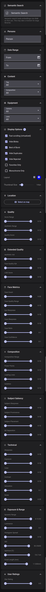

# 网页查看器

> 🌐 [English](../VIEWER.md) · [Français](../fr/VIEWER.md) · [Deutsch](../de/VIEWER.md) · [Italiano](../it/VIEWER.md) · [Español](../es/VIEWER.md) · [Português](../pt/VIEWER.md) · **简体中文**

查看器是一个 FastAPI + Angular 网页应用，用于浏览、筛选、选片和管理你的照片。

## 目录

- [启动查看器](#启动查看器) · [身份验证](#身份验证) · [筛选选项](#筛选选项) · [排序](#排序) · [审阅决定](#审阅决定) · [照片库功能](#照片库功能)
- [全景照片与包围曝光](#全景照片与包围曝光)
- [人物管理](#人物管理) · [触发扫描](#触发扫描) · [语义搜索](#语义搜索) · [相册](#相册)
- [AI 点评](#ai-点评) · [AI 照片描述](#ai-照片描述-gpu-16gb24gb-edition) · [回忆（“那年今日”）](#回忆那年今日) · [时间线视图](#时间线视图) · [地图视图](#地图视图) · [照片胶囊](#照片胶囊)
- [文件夹视图](#文件夹视图) · [GPS 筛选对话框](#gps-筛选对话框) · [人物合并建议](#人物合并建议) · [导出到后期软件](#导出到后期软件) · [下载](#下载) · [选片](#选片) · [废片清理](#废片清理) · [两两比较模式](#两两比较模式)
- [EXIF 统计](#exif-统计) · [键盘快捷键](#键盘快捷键照片库) · [撤销](#撤销) · [渐进式网页应用](#渐进式网页应用) · [移动端](#移动端) · [数码相框与展示屏端点](#数码相框与展示屏端点) · [手机自动上传](#手机自动上传)
- [配置](#配置-2) · [性能](#性能) · [API 端点](#api-端点) · [JPEG XL 照片](#jpeg-xl-照片) · [疑难解答](#疑难解答)

> **功能所需条件**在正文中就地标注：`[GPU]` · `[16gb/24gb]`（VRAM 配置档） · `[Edition]`（编辑密码） · `[Superadmin]`。参见[功能矩阵](INSTALLATION.md#各功能的要求)。

> **AI 助手**：Facet 可以把它的工具提供给支持 MCP 的助手。凭相应级别的令牌，它们可以搜索、修改并筛选照片库。参见 [AI 智能体（MCP）](AGENTS.md)。

## 启动查看器

### 生产环境

```bash
python viewer.py
# 打开 http://localhost:5000
```

它会在同一个端口上同时提供 API 和预编译好的 Angular 应用。

若需要更高吞吐量，请以生产模式运行（Uvicorn，不自动重载）。添加 `--workers N` 可横向扩展（默认为 1）：

```bash
python viewer.py --production --workers 4
```

### 开发环境

分别启动 API 服务器和 Angular 开发服务器：

```bash
# 终端 1：API 服务器
python viewer.py
# API 位于 http://localhost:5000

# 终端 2：带热重载的 Angular 开发服务器
cd client && npx ng serve
# 打开 http://localhost:4200（API 调用会代理到 :5000）
```

## 身份验证

### 单用户模式（默认）

可用一个可选密码保护查看器：

```json
{
  "viewer": {
    "password": "your-password-here"
  }
}
```

两个密码控制访问：

- **`viewer.password`** 决定谁可以*浏览*。留空表示任何人都可浏览整个照片库；设置后，用户必须先登录。
- **`viewer.edition_password`** 是所有编辑操作的前提：评分、收藏与拒绝、选片、相册、人物与人脸管理、比较模式、权重与优先级修改以及导出。留空（出厂默认）时，安装为**只读**：编辑会被 `403` 拒绝（“Set viewer.edition_password to enable editing”）。

按需 AI 生成（描述、VLM 点评）同样需要编辑密码。没有它时，你只能看到已缓存的内容（`source: "none"` 或 `vlm_available: false`）。未设置编辑密码时，图库也会隐藏已有的星级、收藏和拒绝徽标，与已加密安装上没有编辑权限的查看者一致。

设置 `viewer.edition_password` 之后请重启查看器：配置不会热重载。

> **警告：** 当 `viewer.password` 为空（出厂默认）时，任何能够访问查看器端口的人都可以浏览整个照片库并下载原始照片。`viewer.py` 默认监听所有网络接口（`--host 0.0.0.0`，Docker 镜像依赖这一点）。在将其暴露到本机之外之前，请先设置 `viewer.password`，或用 `--host 127.0.0.1` 绑定到回环地址。在 Docker 中，请将端口发布为 `127.0.0.1:5000:5000`。只要 `viewer.password` 为空，查看器就会在启动时记录一条警告（除非已指定绑定回环地址）。

登录时还会把会话令牌写入一个 `HttpOnly`、`SameSite=Lax` 的 Cookie，这样缩略图和扫描进度流在已加密的安装上也能加载。该 Cookie 仅对只读请求（GET/HEAD）生效；编辑仍然需要 Bearer 令牌。退出登录（`POST /api/auth/logout`）会清除它。

### 多用户模式

适用于家庭 NAS 场景，每位成员都有各自的私有照片目录。在 `scoring_config.json` 中添加 `users` 段即可启用：

```json
{
  "users": {
    "alice": {
      "password_hash": "salt_hex:dk_hex",
      "display_name": "Alice",
      "role": "superadmin",
      "directories": ["/volume1/Photos/Alice"]
    },
    "bob": {
      "password_hash": "salt_hex:dk_hex",
      "display_name": "Bob",
      "role": "user",
      "directories": ["/volume1/Photos/Bob"]
    },
    "shared_directories": [
      "/volume1/Photos/Family",
      "/volume1/Photos/Vacations"
    ]
  }
}
```

请按扫描器存储的写法填写 `directories` 与 `shared_directories` 中的每个条目。在 Windows 和 macOS 上，以及 UNC 或盘符条目，匹配时忽略 ASCII 大小写；在其他系统（例如 Linux）上区分大小写。非 ASCII 的大小写差异，以及主机无法解析的映射驱动器，都不会匹配。

用户只能通过 CLI 创建（没有注册界面）：

```bash
python database.py --add-user alice --role superadmin --display-name "Alice"
```

完整参考见[配置](CONFIGURATION.md#用户)。

### 角色

| 角色 | 查看自己的 + 共享的 | 评分／收藏 | 管理人物／人脸 | 触发扫描 |
|------|:-:|:-:|:-:|:-:|
| `user` | 是 | 是 | 否 | 否 |
| `admin` | 是 | 是 | 是 | 否 |
| `superadmin` | 是 | 是 | 是 | 是 |

### 照片可见性

每位用户能看到自己目录中的照片，外加共享目录中的照片。这适用于所有地方：照片库、缩略图、下载、统计、筛选项以及人物页面。

### 按用户存储的评分

在多用户模式下，星级评分、收藏和拒绝标记按用户存储在 `user_preferences` 表中。Alice 的收藏不会影响 Bob 看到的内容。

迁移已有的单用户评分：

```bash
python database.py --migrate-user-preferences --user alice
```

## 筛选选项

照片库的文本搜索会保留 Unicode 单词，并将文件名中的标点视为单词边界。`IMG_0042.JPG` 会同时搜索前缀 `IMG`、`0042` 和 `JPG`。西里尔文和中日韩文字均可搜索。`OR` 等 FTS 运算符会被视为普通字面词。

### 侧边栏标签页

筛选侧边栏把各分区归入五个标签页，以图标显示（悬停可看名称）。图标上的小徽标统计该标签页内已启用的筛选数，标签页对屏幕阅读器保留完整名称（“浏览，2 项已启用”）。上次使用的标签页会记在此浏览器中（`facet_sidebar_tab`）。浏览、画质和主体有可折叠面板，各自记住是否展开；审阅和显示没有。

| 标签页 | 分区 |
|--------|------|
| **浏览** | 语义搜索、人物、日期范围、内容、相册、位置、文件夹、摄影器材 |
| **审阅** | 决定，然后是连拍、重复项、眨眼、包围曝光、全景和已拒绝，各一行菜单，星级评分，收藏和黑白开关，以及（编辑者可见的）*手动人脸需要检查*和*全景识别修正* |
| **画质** | 画质、色彩与画质、扩展画质指标、技术指标、曝光与动态范围（图像本身的好坏） |
| **主体** | 人脸指标、构图、主体显著性、拍摄时刻（画面中有什么） |
| **显示** | 视图（卡片大小、布局、快速滚动、卡片操作） |

标题栏、**查找筛选条件**、智能相册提示和文件名搜索在每个标签页上都固定在标签页上方，因此 `/` 在任何标签页都有效。在**查找筛选条件**中输入会隐藏标签页，并列出所有标签页中匹配的滑块。

**筛选**旁的数字是所有已启用筛选的总数。最小/最大范围只计一次，位置筛选也是。文件名搜索和*相似于*不属于任何分区，只计入这个总数，本安装隐藏的指标上的筛选也一样，这样**重置筛选**仍能清除它。只要有筛选启用，计数旁就会出现**重置筛选**（带提示）；最右侧单独的 **X** 只在窄屏上用于关闭侧边栏。

在“审阅”标签页上，决定和每个分组（例如“重复项”）各是一行，显示当前值（如已隐藏、已显示或仅这些）并打开选项菜单，每个选项都有一行说明。保持默认值的行不计入标签页或标题栏的徽标。“仅”与“已隐藏”互相排斥。选择了决定时，“已拒绝”会被锁定，其提示会说明原因。星形按钮设置最低评分：每次点击加一，点到 5 之后再点一次，或在来自链接的最大值之后点击，会清除它。它与仅有图标、带提示的收藏和黑白开关共用一行。在“画质”和“主体”标签页上，悬停在设置名称上会说明评分内容及所用模型，审阅控件也有提示。

<details><summary>完整的筛选侧边栏——所有分区均已展开（点击查看）</summary>
<p align="center"></p>
</details>

### 主要筛选条件

| 筛选条件 | 可选项 |
|--------|---------|
| **照片类型** | 精选照片、人像、环境人像、风光、建筑、自然、动物、艺术与雕像、黑白、弱光、剪影、微距、天文摄影、街拍、长曝光、航拍与无人机、演唱会 |
| **画质等级** | 良好（6+）、优秀（7+）、出色（8+）、最佳（9+） |
| **相机与镜头** | 按器材筛选 |
| **人物** | 按已识别的人物筛选 |
| **类别** | 按照片类别筛选 |

### 高级筛选条件

| 分类 | 筛选条件 |
|----------|---------|
| **日期** | 起始日期与结束日期 |
| **评分** | 综合评分、美观度、TOPIQ 评分、画质评分 |
| **扩展画质** | 美学评分 IAA（艺术价值）、人脸画质 IQA、LIQE 评分 |
| **人脸指标** | 人脸画质、眼睛清晰度、人脸清晰度、人脸占比、人脸检测置信度、人脸数量 |
| **构图** | 构图评分、构图交点、引导线、主体突出程度、构图模式 |
| **主体显著性** | 主体清晰度、主体突出程度、主体位置、背景分离度 |
| **技术指标** | 清晰度、对比度、动态范围、噪点水平 |
| **色彩** | 色彩评分、饱和度、亮度、直方图分布；色温和色相区间（需要 `--recompute-colors`） |
| **曝光** | 曝光评分 |
| **用户评分** | 星级评分 |
| **相机参数** | ISO、光圈（f 值区间滑块）、焦距（区间滑块） |
| **内容** | 标签、黑白开关 |
| **拍摄时刻** | 叙事时刻置信度（0–1 区间滑块：`min_moment_confidence` / `max_moment_confidence`） |

有些范围筛选只匹配有数值的照片，因此即使筛选从 0 开始，也会排除未评分的照片：

- **美学 IAA、人脸画质 IQA、LIQE、Aesthetic V2.5、Q-ReAlign、DeQA**：模型未能评分的照片没有数值。按这些指标升序排序时，它排在最后，无论在图库还是相册中。见[补充 IQA 维度](SCORING.md#补充-iqa-维度)。
- **主体清晰度、主体位置、背景分离度、构图交点**：检测不到主体的照片没有数值，详情面板也会省略该行。这类照片的主体突出程度为 0.0。参见 [SCORING.md](SCORING.md)。

### 构图模式

按 SAMP-Net 检测出的 8 种模式筛选（来自 `models/samp_net.py`）：
- global、horizontal、vertical、triangular
- surround、quarter、cross、rule_of_thirds

## 排序

页眉（以及移动工具栏）中的排序按钮显示当前排序的图标；其提示文字为`排序方式：<当前排序>`。它会打开一个包含全部排序的分组菜单。升序/降序切换按钮紧挨在它旁边。不同的评分模型使用简短标签（IAA、2.5、Q-R、DeQA、LIQE 和 IQA）。

**记住的排序。** 照片库会以您上次选择的排序打开，该选择优先于 `viewer.defaults.sort`。它按浏览器保存在 `localStorage` 中，而不是按账户保存。

- 只有在排序菜单中做出的选择才会被记住。来自共享链接或助手的排序不会被记住，且链接自身的 `sort` 优先。
- 再次选择配置的默认排序，或重置筛选条件，会清除该记忆。
- **相关性**从不被记住，因为它需要搜索查询。

快门速度按时长排序，因此 `1/250` 与 `0.004` 相等。缺失或无效的值在两个方向上都排在最后。

可排序的列按分组列出（来自 `viewer.sort_options`）：

| 分组 | 列 |
|-------|---------|
| **常规** | 综合评分、美观度、画质评分、拍摄日期、星级评分、美学评分（IAA）、LIQE 评分、Q-ReAlign（美观度）、DeQA、美学 v2.5（后三项在照片具有该评分后才会出现） |
| **人脸指标** | 人脸画质、人脸画质（IQA）、眼睛清晰度、人脸清晰度、人脸占比、人脸数量 |
| **技术指标** | 技术清晰度、对比度、噪点水平 |
| **色彩** | 色彩评分、饱和度 |
| **曝光** | 曝光评分、平均亮度、直方图分布、动态范围 |
| **构图** | 构图评分、构图交点评分、引导线、主体突出加分、构图模式 |
| **主体显著性** | 主体清晰度、主体突出程度、主体位置、背景分离度 |
| **内容** | 时刻分组置信度（NULL 值排在最后） |

### 我的偏好

按个人排序模型的 `learned_score` 排序：即它从你的 A/B 比较、评分和选片决定中学到的偏好。排序旁边的徽章显示覆盖率（有学习评分的照片占比）以及模型在留出集上的准确率，方便你判断该在多大程度上信任它。用 `python facet.py --train-ranker` 训练或刷新该模型。

由 `viewer.features.show_my_taste` 控制（默认：`true`）。模型状态：`GET /api/ranker/status`。

### 商业模式下隐藏的指标

当 `licensing.mode` 设为 `commercial` 时，查看器会隐藏模型不可商用的指标：LIQE、Aesthetic IAA、Face Quality IQA（未安装 OFIQ 时）、DeQA（未设置 `licensing.allow_unclear` 时）以及 Aesthetic V2.5。它们的筛选器、筛选标签和排序选项都会消失；`/api/config` 在 `unavailable_metrics` 中列出这些指标。在权重调整页面，它们的滑块仍可见但被禁用，评分时会舍弃并重新归一化这些权重。更改许可模式后请重启查看器。

## 审阅决定

在照片库中选择 **审核状态 → 待审核**，逐一处理尚未决定的照片。此视图按**拍摄日期从旧到新**排序；你可以反转顺序，或按日期、文件夹和相册缩小范围。选择审核状态会退出语义搜索和相似照片搜索。

- 想要的照片选**保留**，不要的选**拒绝**。两者都会让照片离开待审核。用**已保留**状态筛选可找到保留的照片。
- 保留与收藏和星级评分相互独立。
- 保留和**重置决定**位于照片详情、右键菜单和批量操作中。按 **K**（可重新映射，参见[键盘快捷键](#键盘快捷键照片库)）保留当前照片。在照片详情中，保留是切换开关。
- **重置决定**会清除保留和拒绝状态，而不改变星级或收藏。
- 决定在刷新、重启和重新扫描后仍会保留。多用户安装中，决定归当前用户所有。
- 确认选片分组时，其中保留的照片会被标记为已保留。已有的评分和收藏不会转换为保留决定。

**进度计数。** 照片库会显示整个可见文件夹、相册或筛选范围内**未决定**、**已保留**和**已拒绝**照片的数量，而不仅仅是已加载的页面。百分比为 `(已保留 + 已拒绝) / 总数`。审核状态和“隐藏已拒绝”开关不会缩小总数；其他筛选会。

**继续一个队列。** **审阅未决定照片**开始一个队列。**继续审阅**会在此浏览器中重新打开你最近的待审核队列，并定位到第一张仍未决定的照片。

- 书签按浏览器和登录身份保存（最多 20 个身份），不会在设备之间同步。
- 更改筛选不会替换书签，除非你打开另一个待审核队列。
- 相册队列使用相册当前保存的条件。
- 临时的连拍/序列分组不会被记入书签，因为重新扫描可能会重新编号。
- 退出登录会清除此浏览器中所有审阅队列书签。

**浮动通知。** 审阅进度、**继续审阅**、隐藏照片通知、活动筛选通知（带**重置全部筛选**）以及缩略图迁移通知会堆叠在右下角。

- 每张卡片的 × 只在当前浏览器标签页中将其隐藏。它会在新标签页中再次出现，或在通知内容变化时出现（另一个范围、隐藏数量变化、增删筛选）。
- 要永久隐藏审阅进度，请使用用户菜单中的“**隐藏审阅进度**”/“**显示审阅进度**”。该选择按浏览器保存，并同时隐藏**审阅未决定照片**按钮。
- 几秒没有交互后，整个栈会收起为一个小计数药丸。悬停或点击它即可展开。

## 照片库功能

### 手动照片堆叠

明确选择 **2–1000 张照片**，在选择栏点击**堆叠照片**或按 **S** 打开 `/stacks/edit` 全页编辑器。整视图选择不能创建堆叠。S 只打开预览，不直接保存。用户菜单 → **自定义快捷键**可更改图库按键；工具提示、帮助和 `?` 参考表均显示当前按键。若旧设置已将 S 分配给其他操作，该设置会保留，堆叠操作显示**未分配**，直到您选择空闲按键。编辑需要编辑权限。每个所有者的每张照片只能属于一个手动堆叠。 页面在常驻缩略图条上方居中显示可缩放预览。点击缩略图或按 `←`/`→` 聚焦照片，再用相应控件设置封面、调整顺序或移除成员。使用缩放按钮、滚轮或双击查看细节。

使用 **Cmd+Shift+S** 或 **Ctrl+Shift+S**，即可按选择顺序立即堆叠明确选择且尚未堆叠的照片，第一张为封面。已有堆叠成员会打开编辑器。成功后清除已提交的选择，撤销会恢复该选择；取消或失败时保留选择。在编辑器中按 Escape 可返回原图库而不保存。

**堆叠时拒绝照片。** 在全页编辑器或堆叠编辑对话框中聚焦照片，点击**拒绝**或按 **R**。建议堆叠暗房中的当前照片提供相同操作；请先打开暗房选择照片。拒绝会立即保存常规审核决定，清除保留、收藏和星级，并仅将该照片从建议堆叠中排除。它不会删除或修改原始文件。计数和变暗的暗房缩略图显示排除项。撤销会恢复先前审核值及仍适用的草稿成员资格，同时保留后续顺序与封面选择；后续审核编辑可能使撤销不可用。已拒绝照片会保留，直到明确排除，且不会产生另一审核决定。分组仍需保存；不保存就离开不会撤销拒绝。

所选照片已有堆叠时，默认使用**合并堆叠**，预览会加入这些堆叠的其他成员。**仅所选照片**只移动明确选择的照片。编辑器显示所选数量、最终数量、额外成员和源堆叠影响摘要；展开详情可逐一检查源堆叠。剩余至少两张照片时保留源堆叠，仅剩一张时该照片取消堆叠，空的源堆叠则消失。从新堆叠中排除的照片按相同规则留在原处。最终堆叠和全部受影响照片各限 1000 张；无法访问或仅部分可见的源堆叠会被拒绝。切换模式时会保留仍适用的顺序、封面和排除项。

检查服务器刷新的预览后，点击**堆叠照片**保存。页面会保持打开，以便检查结果；通知仍可用且版本匹配时，可点击**撤销**。**继续编辑**会在再次保存前获取新预览。**返回图库**按原始 URL 返回原图库或相册，并使之前的撤销失效。未保存就离开会放弃分组更改；明确拒绝的决定仍会保存。重新加载浏览器仅会为同一账户恢复选择，且须重新授权；直接打开没有有效选择状态的 URL 时，页面会提供返回入口。

点击数量徽章或堆叠照片会打开照片查看器，缩略图条、上一张/下一张按钮和位置计数按存储顺序浏览有权查看的成员。方向键始终留在堆叠内。**管理堆叠**打开辅助对话框：点击缩略图或使用左右方向键查看大图，选择**封面**、用箭头按钮排序或移除成员。仅打开编辑器时仍采用普通成员编辑规则：移除的成员取消堆叠，移除封面会选择首个剩余成员，不足两张或点击**取消堆叠**则解散堆叠。明确**添加已选照片**且涉及其他堆叠时，才会切换到重新分组预览及其两种模式。分组编辑会保留文件和审核值；单独的明确拒绝操作会立即更改审核值。

- 评分、保留/拒绝、元数据、下载、相册和删除操作绝不会隐式展开堆叠。

**在照片库中。** 堆叠折叠为一张图块；**展开所有堆叠**会保存为显示偏好。筛选和相册成员关系作用于单张照片：封面匹配时显示封面，否则显示第一个匹配的成员。堆叠浏览绕过自动连拍/重复隐藏规则。时间线和地图逐张显示照片。

**选择。** 选择折叠的图块只选择显示的那张照片。打开堆叠并使用**选择全部 N 个成员**可选择整组。**选择视图中的全部照片**、百分比选择和助手 `target:view` 包含所有匹配的照片，包括折叠的成员，整视图操作执行前会先显示实际照片数。在 API/助手摘要中，`total` 表示显示的图块数，`photo_total` 表示照片数。

**隐私与持久性。**

- 堆叠仅属于其所有者（单用户模式下为当前安装）。编辑需要编辑权限。
- 公共分享和查看器导出不包含堆叠。部分可见的堆叠为只读。
- 重新扫描会保留封面、顺序和成员。普通数据库备份会保留堆叠。
- 完整的查看器数据库导出会省略堆叠，以及筛选条件引用私有堆叠的智能相册，还有筛选条件无法读取（JSON 无效、嵌套过深或超过 1 MiB）的智能相册。增量更新会保留目标数据库自己的相册和堆叠。
- [Immich 堆叠导入/推送](IMMICH.md#手动堆叠导入和推送)是单独的 CLI 操作。

**建议堆叠**在 `/culling?mode=stacks` 打开全页审阅，保留当前图库筛选条件，并提供返回原图库或相册的入口。需要编辑权限。它审阅已有的重复照片和连拍组，忽略连拍/重复隐藏规则，以显示每个成员。

- 在网格中，`↑`/`↓` 选择组，**Enter** 打开暗房，**S** 按建议封面堆叠。在暗房中，`←`/`→` 聚焦照片，**S** 或 **Enter** 以该照片为封面堆叠。**X** 跳过；堆叠和跳过均提供撤销。
- 在暗房中点击**拒绝**或按 **R** 会排除当前照片。堆叠只保存剩余照片，且至少需要两张。跳过会忽略原始建议。剩余不足时，仍可查看排除照片、切换分组、撤销、跳过或返回。 完成建议后，拒绝标记仍会保留。撤销堆叠或跳过会恢复该建议的排除项；后续建议会开始新的草稿。
- 暗房保留可缩放大图、放大镜、对比和缩略图条。**Z** 切换缩放，**P** 切换对焦峰值，**G** 循环切换构图网格，**F** 切换全屏，**Escape** 返回分组网格。**编辑成员**打开辅助对话框；建议仅剩一张照片时会提供**跳过此堆叠**。
- 跳过按账户保存，直到组成员发生变化。已有堆叠照片或包围曝光/全景帧所在的组会被排除；重叠组会整组排除，并优先保留重复组。
- 标题栏显示已加载建议数，而非照片库总数。每批最多 20 条建议和 2000 张照片，每组最多 1000 张。仅在所有已加载建议均已堆叠或跳过后，才自动加载下一批。**重新加载建议**会重新读取同一范围；**返回图库**回到原处。
- 固定列表、相似照片和语义搜索中不提供此功能。堆叠和跳过不会改变审核决定或原始文件。只有明确拒绝操作会更改照片审核值。

### 照片卡片

- 带评分徽章的缩略图。悬停可查看该评分在你的照片库中的位置（“位列图库前 18%”）。
- 可点击的标签，便于快速筛选
- 已识别人脸的人物头像
- 类别徽章
- 右键单击（或按 Shift+F10）可打开[右键菜单](#多选与批量操作)

在照片详情中，各项指标分布在图标标签页中：EXIF 数据（如有）、质量、构图（含主体显著性）、技术和直方图。会记住上次打开的标签页。每个评分旁边显示其在整个图库中的分布，并突出显示照片所在的柱；悬停某根柱可查看照片的排名和图库的取值范围。该位置基于整个图库计算，而非当前筛选条件，精度为 20 根柱中的一根。

### 多选与批量操作

点击照片选中，Shift+点击可范围选择。左下角会出现带图标按钮的操作栏（悬停可查看名称）。批量操作需要编辑模式。

- **收藏**——把所有选中照片标为收藏（并清除拒绝标记）
- **拒绝**——把所有选中照片标为拒绝（并清除收藏和评分）
- **评分**——设置或清除 1–5 星评分
- **添加到相册**——加入已有相册或新建相册
- **编辑标签**——为所有选中的照片添加或移除一个[手动标签](#手动标签)
- **全选**——在没有任何选中项时，选中当前筛选条件匹配的每一张照片，而不仅仅是已加载的页面。若已选中一些照片，则加入已加载的照片，并可进一步扩大到整个视图。整视图操作执行前会先确认确切的照片数量。
- **反选**——把选择换成它的补集。在没有选中项时就是整个视图。在已有选中项时，则限定在已加载的照片内：先挑出要保留的，再反选，再拒绝。
- **比较**——并排打开 2–4 张照片，平移和缩放同步（滚轮缩放、拖拽平移、双击复位）。缩放后窗格会切换到全分辨率。
- **复制文件名**——把文件名复制到剪贴板。整个视图的复制会先确认；超过 10 000 张照片会被拒绝。
- **导出**——在文件旁写入 XMP 附属文件（参见[导出到后期软件](#导出到后期软件)）
- **选片后导出／清理**——把保留照片复制，或把拒绝照片移动/移入回收站到一个文件夹（参见[选片后导出／清理](#选片后导出清理)）
- **删除**——把照片送入系统回收站（参见[删除](#删除)）。仅在 `viewer.cull.allow_trash` 开启时显示。在“选中整个视图”的选择下被禁用：请明确选择照片。
- **下载**——下载选中的照片
- 按 Escape 键或“清除”按钮可清除选择。

双击照片可打开它。

**右键菜单。** 右键单击一张照片，或使其获得焦点后按 Shift+F10 / 菜单键。

- 对位于多张照片选择之内的照片，它作用于整个选择，提供操作栏中的操作（“反选”和“全选”除外），包括**编辑标签**。
- 对其他任何照片，它只作用于该照片，并额外提供打开照片、查找相似照片、为什么是这个评分？、将元数据写入文件和将人脸分配给人物（照片有未分配的人脸时），各自受相应条件限制。
- 从菜单中筛选单张照片，只会把该照片移出选择。
- 触控优先的设备（`hover: none` 且 `pointer: coarse`）上不提供；请改用“操作”面板。

### 保留前 N%

工具栏中的 **保留前若干 %** 控件（编辑模式）可一步完成对整个筛选视图的选片。设定一个百分比，Facet 会按**当前排序**（综合评分、我的偏好、精选照片、清晰度……）对视图排序，保留排在前面的部分，并**选中其余照片**。你可以先取消选中想要留下的照片，再从操作栏中把它们拒绝。

- 不会移动或删除任何文件；它只是填充选择。拒绝仍会训练“我的偏好”。
- 选择上限为 5000 张照片。视图过大时，请缩小筛选范围（相册、日期、人物……）。
- 在默认的 `hide_brackets` / `hide_panoramas` 之下，一组包围曝光或全景照片只算**一张**照片。

### 助手固定的列表

当通过 [AI 智能体（MCP）](AGENTS.md)连接的助手向你展示一份精确的照片列表时，图库会按助手的顺序显示该列表。状态行会说明选了多少张照片；点击**返回常规视图**会恢复你的筛选。

- 显示列表期间，筛选栏、标签、人物头像、**查找相似照片**以及基于筛选的操作（如**保留前 N%**）都会隐藏。更换相册仍会替换该列表。
- 显示列表会清除你的选择和侧边面板。
- 助手的写入无需重新加载即可显示：有变化的卡片会刷新，被删除的照片会离开列表。被 `cull_apply` 移动或移入回收站的照片仍留在列表中。每一波变化只出现一条“助手更改了 N 张照片”的提示。参见[实时更新](AGENTS.md#实时更新)。

**助手运行中标记。** 助手在你的标签页中工作时，每次写入或命令之后，页眉会出现 **助手运行中** 标记，持续几秒。点击它会打开 **助手活动**：本次会话最近 50 个操作（重新加载后丢失），含工具、照片数量和时间。指明了照片的操作带有**显示照片**按钮。经助手请求，标签页会告诉它你的光标在哪张照片上（`focused`）以及自它上次查看以来你做了什么（`user_activity`）。不会主动发送任何内容。参见[控制已打开的标签页](AGENTS.md#控制已打开的标签页)。

### 选片后导出／清理

批量操作栏中的**选片后导出／清理…**（编辑模式）可把保留照片复制，或把拒绝照片移动/移入回收站到目标文件夹。回收站指系统回收站，绝不是永久删除，并且需要 `viewer.cull.allow_trash`。

- **每次运行都从试运行开始。** 写入任何内容之前你会先看到预览；移动/回收站只在显式传入 `dry_run=false` 时才会执行。
- **服务器根据每张照片自身的状态挑选文件。** 复制只作用于保留照片，移动/回收站只作用于拒绝照片。其他一切都计入 `excluded_by_state`。客户端无法提交要删除的文件清单。
- **配套文件需主动开启。** 拒绝一张 JPEG 不会连带它的 RAW，除非你勾选**包含配套的 RAW／XMP 文件**（`include_companions`）。
- 在 macOS 和 Windows 上，配套 RAW 文件保留磁盘上的文件名，包括大写扩展名；在 Windows 上，`.xmp` 附属文件同样如此。

**“将淘汰照片移入回收站”的可用性。** 只有当 `viewer.cull.allow_trash` 已开启，*并且*已安装 `send2trash` 包时，才会出现“将淘汰照片移入回收站”选项（`/api/config` 报告 `cull.trash_available: true`）。否则对话框会说明原因：“未安装 `send2trash` 软件包”或“管理员已禁用回收站功能”。

**多帧照片组。** 在默认的 `hide_brackets` / `hide_panoramas` 之下，选择只包含包围曝光的基准曝光帧，或全景的中间帧。因此默认情况下，处理一组照片只作用于那**一个**文件。两个可选复选框可以扩大范围：

- **包含配套的 RAW／XMP 文件**（`include_companions`）会加上同一帧的 RAW 和 `.xmp` 附属文件。
- **包含同组其他照片**（`include_sequence_siblings`）会加上该组的其他帧，但仅限自身保留/拒绝状态与本次操作相符的帧。保留的帧绝不会因为同组某张被拒绝而被移入回收站。你取消选择的帧绝不会被重新拉回。
- 预览始终会报告存在多少张同组照片（`sequence_siblings`）。`matched` 用来区分“没有符合条件的照片”和结果为空。
- 移动或移入回收站某组的代表帧时，会提升一张幸存的同组照片，使该组保持可见。
- 若想精确挑选一组中的部分照片，请先通过照片详情中的“在照片库中打开此照片组”操作打开它。该视图会显示每一帧。

基于筛选的选片遵循与照片库相同的筛选规则，包括照片类型。超过 10 000 张照片的视图会被拒绝而不是截断，即使是试运行也一样：请缩小范围（相册、日期、人物……）后重试。详情：[API.md](../API.md)。

**可以写入哪里。** 在未配置 `viewer.export.allowed_target_dirs` 时，Facet 只会写入你的扫描目录内。照片树下的子文件夹（例如 `_rejected`）无需任何设置即可使用。若要使用其他位置的文件夹，请把它加入 `viewer.export.allowed_target_dirs`。参见[配置——导出与选片目标目录](CONFIGURATION.md#导出与选片目标位置)。在 Docker/Podman 中，路径是在**容器内部**解析的——参见[部署——容器路径语义](DEPLOYMENT.md#容器路径语义)。

**每个操作都提示“拒绝访问”。** 这是刻意的拒绝：目标文件夹不被允许，或你的编辑会话已过期。请在浏览器的“网络”面板中查看失败请求的 `detail` 字段。真正的文件系统问题表现不同：操作部分成功并带有非零的 `errors` 计数，操作系统的错误则记录在服务器日志中。

### 删除

照片详情和选择栏中的**删除**会把文件直接送入系统回收站（可恢复，通过 `send2trash`）。它与“选片后导出／清理”以及 `/culling` 暗房是分开的，使用同一个 `viewer.cull.allow_trash` 开关。

- **库记录立即移除。** 与“选片后导出／清理”不同，照片的行在文件被送入回收站后立即移除，无需 `--cleanup-missing-photos`。被带入、且作为独立照片扫描过的配套 RAW 也会一并移除。
- **仅限显式选择。** 最多 10000 个路径；“选中整个视图”被禁用。
- **范围。** 默认仅为指定的文件。**包含配套的 RAW／XMP 文件**（`include_companions`）和**包含同组其他照片**（`include_sequence_siblings`）可以扩大范围，与“选片后导出／清理”相同。两者默认关闭。
- **包围曝光的基准曝光帧受保护。** 包围曝光的基准帧（`sequence_ev_offset = 0`）会被拒绝（`refused_bracket_lead`），除非包含同组照片；此时整组包围曝光会一起删除。被删除的全景代表帧会提升一张幸存的同组照片。
- **部分结果。** 每个路径单独报告。被拒绝的包围曝光基准帧不会阻止其余部分。送入回收站失败的文件（`errors`）会保留其行。
- **磁盘上已缺失的文件。** **同时移除磁盘上已缺失文件的库记录**（默认勾选）会一并移除这些行，并在 `removed_missing` 中报告。取消勾选时，它们以 `skipped` 返回，行保留。扫描目录之外的路径，或位于缺失或为空的文件夹（卷掉线）中的路径，始终留在 `skipped` 中。整库扫除请用 `--cleanup-missing-photos`。

响应字段和状态码：[API.md](../API.md)。

### 显示选项

- **布局模式**——**网格**（大小一致的卡片）或**拼贴**（保留宽高比的对齐行），在任何屏幕宽度下都可用。
- **缩略图大小**——调整卡片/行高的滑块（120–400px，保存在 localStorage 中）
- **隐藏照片详情**——隐藏卡片上的元数据（仅网格模式）
- **提示信息**——照片详情的显示方式：**侧边面板**（默认）、**悬停**、**点击**或**关闭**。
  - 侧边面板在右侧抽屉中显示完整详情，排布与照片详情相同。它同时响应悬停和点击，因此在触摸屏上也能使用。光标离开网格时它会保留最后一张照片。
  - 点击一张照片会把面板锁定在该照片上，直到你点击**取消选择**（这也会取消选中该照片）。按 **Esc** 效果相同，并会清除选择。
  - 面板与筛选共用抽屉；打开筛选会将其隐藏。需要至少 1280px 的视口宽度。
  - **悬停**和**点击**会显示简短的气泡：类别、综合评分及排名、美学、构图、清晰度、曝光，以及一行 EXIF。
- **自定义卡片按钮**——调整照片卡片悬停按钮的顺序与显隐。可用九个操作：找相似、评分详情、写入元数据、指派人脸、查看重复照片组、连拍组、包围曝光/全景组或照片堆叠，以及打开照片页。组按钮只在属于对应组的照片上出现。重复照片组和照片堆叠按钮默认开启；其他默认关闭。按浏览器保存。
- **隐藏闭眼照片**——隐藏检测到闭眼的照片
- **仅看眨眼 / 仅看重复**——只显示闭眼的照片，或每个重复组的全部成员。该视图下各隐藏开关暂停生效。
- **仅看已淘汰照片**——只列出你已拒绝的照片。可全选后用**选片后导出／清理**处理，或使用选片中的**将全部已拒绝照片移入系统回收站**。两者都把筛选范围限制为 10,000 张照片；数量更多时请按日期或相册缩小范围，并关闭隐藏组成员的筛选条件以包含每一张已拒绝的帧。选择审核状态时被禁用。
- **连拍最佳照片**——每组连拍只显示评分最高的一张
- **包围曝光最佳照片**——每组包围曝光只显示基准曝光帧。**默认开启。**它与“连拍最佳照片”相互独立，因为包围曝光的连拍代表帧不一定是基准曝光帧。
- **全景组最佳照片**——每组全景或 HDR 全景只显示中间帧。**默认开启。**
- **无限滚动**——照片随滚动逐步加载
- **快速滚动（虚拟化）**——只渲染视口附近的行，因此深度滚动依然流畅。默认开启。若遇到布局问题，可在侧边栏的“显示”标签页中关闭。网格模式且显示详情时始终完整渲染。保存在 localStorage 中（`facet_virtual_scroll`）。

### 相似照片

点击照片上的**相似**，选择一种模式：

- **视觉相似度**（默认）——pHash 相似度（70%）+ CLIP/SigLIP 相似度（30%）。两张照片只共享其中一种特征时，该特征按全部权重计算；两种都不共享的照片永远不会列出。高于阈值的所有匹配都会分页返回。如果照片两种特征都没有，请用 `--force` 重新扫描（单纯的 `python facet.py <dir>` 会跳过已处理的文件）。
- **色彩**——直方图交集（70%）+ 饱和度距离（10%）+ 亮度距离（10%）+ 黑白加分（10%）。会先按黑白标记和饱和度范围预筛选。
- **人物**——包含同一（或同几位）人物的照片，可用时按 `person_id`，否则按人脸嵌入向量相似度。

**相似度阈值滑块**（0–90%）控制匹配的严格程度（人物模式下不显示）。结果支持无限滚动。

### 筛选条件标签

生效中的筛选条件以可移除的标签形式显示在照片库顶部，并带有数量。

### 手动标签

手动标签是你自己输入的标签，与 AI 标签并存。它们单独存放（`photo_manual_tags`，而不是照片的 `tags` 列），因此重新扫描和重新打标永远不会清除它们。

- **显示位置。** 仅在照片**详情**中，以与 AI 标签有区别的标记显示。卡片和提示框显示 AI 标签。
- **谁能编辑。** 编辑模式用户。未设置 `viewer.edition_password` 的安装上为只读。AI 标签无法移除。
- **批量编辑。** 选中照片后使用**编辑标签**（选择栏、移动端“操作”面板或右键菜单），添加或移除一个标签。整个视图的选择同样可用。已有 50 个手动标签的照片会被跳过；`count` 报告实际被修改的照片数。
- **格式。** 标签会去除首尾空白、转为小写并压缩连续空白（NFC）。最多 64 个字符，每张照片最多 50 个。空标签、含逗号或含控制字符的标签会被拒绝。与照片某个 AI 标签相同的标签不会被存储。
- **搜索和筛选都能找到它们。** 标签筛选、文本搜索、语义搜索（`/api/search`，仅限说明文字的范围除外）、标签下拉列表、统计，以及附属文件/嵌入/Lightroom 导出，都使用 AI 标签与手动标签。文本搜索把手动标签作为完整短语匹配。
- **例外。** 精选集只统计 AI 标签。手动标签从不影响评分、类别或叙事时刻。
- **对分享链接隐藏。** 通过分享链接访问的查看者永远看不到它们。共享的智能相册仍会应用所有者保存的筛选。
- **所有用户共享。** 在多用户模式下，任何编辑模式用户都可以移除他人添加的标签。
- **不可撤销。** [撤销](#撤销)不涵盖它们。被移除的标签也可能从附属文件中回来；参见[冲突规则](INTEROP.md#冲突规则)。
- **导入的标签。** `--import-sidecars` 会把无法识别的附属文件关键字（既不是 AI 标签也不是人物姓名）存为来源为 `xmp` 的手动标签。
- **与文件路径绑定。** 移动或重命名文件会使其失去手动标签。

## 全景照片与包围曝光

全景照片的各帧是为了拼接而拍的，包围曝光的各帧是为了合成而拍的，它们不是一组互相竞争的照片。仅靠连拍检测会把它们归为一组，并只留下一张、隐藏其余，因此 Facet 单独检测这些照片组。

**在照片库中。** `包围曝光最佳照片`和`全景组最佳照片`（默认均开启）每组只显示一帧：包围曝光取基准曝光帧，全景取中间帧。该帧会在星标和爱心旁边带一个小图标：普通扫拍、HDR 扫拍或包围曝光。只有当对应的开关确实正在隐藏该组其余照片时，图标才会出现。

**在选片中。** 粒度菜单把`包围曝光`、`全景`和`HDR 全景`作为各自独立的列表提供，绝不并入`全部`。每一帧一开始都被标为保留，确认一组时不会记录任何比较对，因此排序模型不会被照片组的拍摄方式所训练。

**修正一组照片。** 检测约有 4% 的照片组会出错。修正是持久的：它们能挺过之后每一次检测运行。两种修正都需要编辑模式、至少两帧，并且可以从提示条撤销。

- **误报**（不是全景，或普通与 HDR 之间的标注）：使用选片中分组操作栏上的修正菜单。
- **漏检的全景**：在照片库中选中这些帧，选择*标记为一组* → *标记为同一组全景照片*。

**标记漏检的包围曝光。** 对于被检测为普通连拍的曝光阶梯：

- 在暗房中，一个普通连拍分组（其中没有任何一帧已属于包围曝光或全景）提供*标记为曝光包围*。
- 在照片库选择栏中，使用*标记为一组* → *标记为一组曝光包围*。
- 这些帧必须构成一段真正的曝光阶梯：至少 2 帧，每一帧都有曝光数据（光圈值、快门速度、ISO）和拍摄日期，且没有两帧曝光值相同。否则标记会被拒绝并给出提示，不会保存任何内容。
- 标记与已有的已标记包围曝光重叠的帧，会扩展那一组。合并后的整组仍须是有效的曝光阶梯。
- 暗房的取景流会隐藏已拒绝的帧，因此在暗房中标记时绝不会包含已拒绝的档位。
- `bracket` 类型的分组会改为提供*取消修正*。
- 如果某个已标记的帧消失，或失去曝光或日期数据，整组会等待，直到每个成员重新满足条件。
- **标记优先于全景检测**：包含已标记帧的检测出的全景，会在下一次运行时被丢弃。

**修正在下一次检测运行时生效。** 修正会立即保存并显示为待应用：照片库图块上有时钟徽章，选片中有*修正待应用*标签。选片页面会显示一条横幅，带有**重新检测**按钮。侧边栏的*全景识别修正*筛选条件（仅编辑模式，位于“审阅”标签页）会在整个照片库范围内列出待应用的修正。*取消修正*可在之后移除一条修正。

**调优。** “比较”下的“全景”标签页包含校准过的阈值：最少帧数、最小扫拍幅度、最长间隔以及 HDR 曝光跨度。保存它们本身不会改变任何东西，需要重新运行检测（按钮就在保存旁边）。参见 [CONFIGURATION.md](CONFIGURATION.md#全景检测)。

## 人物管理

> 浏览人物对所有查看者开放；重命名、合并、更换头像和分配人脸需要 `[Edition]`。

### 人物筛选

下拉列表显示带人脸缩略图的人物。点击即可筛选照片库。

### 人物照片库

点击人物名称，在 `/person/<id>` 查看该人物的全部照片。在管理人物页面中，双击人物卡片（已命名、“待命名”中的未命名或已忽略）会打开该人物照片的图库；在名称输入框、复选框和按钮上的双击不受影响。

**从图库命名。** 当图库按某个人物筛选时（`?person_id=95`），当前筛选标签行中该人物的标签会显示其面孔和名称，未命名时显示 **未命名**，并以描边提示命名；标签的 ×（**从筛选中移除**）会把此人移出筛选。对编辑用户，× 前有两个按钮。**重命名**（铅笔）可就地重命名：未命名人物的名称输入框显示“这是谁？输入或选择名称”，已命名人物则显示“重命名或合并到…”；建议会显示每个人物的面孔、名称和照片数量，点击 **保存** 或 **取消** 关闭（按 Esc 也可取消）。名称总是先保存（`POST /api/persons/{id}/rename`）；如果其他分组已使用该名称（不区分大小写和空格，无论是否在建议列表中），该标签随后会提供与“管理人物”页面相同的合并（见下文 **重命名**），合并后图库会切换到保留的人物。**更多**（⋮）打开人物菜单：**查看 {name} 的所有照片**、**查找 {name} 的更多面孔** 和 **忽略**（已忽略的人物则为 **恢复**）。当图库的隐藏选项让此人的部分照片不可见时，图库提示会给出隐藏数量，并按连拍、闭眼、重复、包围曝光和全景照片分别列出，便于您在命名前将其显示出来。

### 管理人物页面

在编辑模式下，页面有两个标签页：**已命名 (N)** 和 **待命名 (N)**，并且总是打开 **已命名**。**待命名** 列出未命名的聚类，每一项都带有命名输入框；**已命名** 包含已命名的人物，已忽略的人物位于其底部可折叠的 **已忽略** 区域。只读用户只能看到已命名人物的网格。名称建议（在此页面、图库人物标签和照片的面孔菜单中）会显示每个人物的面孔、名称和照片数量。在 **待命名** 中，排序菜单提供 **面孔数量** 和 **最新**。没有需要命名的人物时，该标签页显示“所有人都已命名。需要命名的新面孔会显示在这里。”

通过顶栏按钮或 `/persons` 访问：

| 操作 | 方法 |
|--------|--------|
| **合并** | 选择源人物，点击目标人物，确认 |
| **删除** | 点击人物卡片上的删除按钮 |
| **重命名** | 点击人物名称就地编辑。如果其他分组已使用该名称（不区分大小写和前后空格），确认框会为每个人物显示一个卡片（面孔、名称、面孔数量），默认全部选中，并标出将被保留的人物：所选人物中最大的那个，并保留其名称写法。取消选择某个同名人物或取消操作，即可让其保持分开。合并无法撤销 |
| **拆分** | 打开某个人物的人脸，选中其中一部分，拆分为新人物 |
| **查找更多面孔** | 人物卡片上的搜索按钮，或人物菜单中的 **查找 {name} 的更多面孔**，会列出与该人物相似的面孔，最相似的排在前面，与该人物的质心比较（`GET /api/person/{id}/possible_faces`）。在 **包含哪些面孔** 下，三个标签各自显示数量：**未分组** 和 **未命名分组** 默认开启，**已命名人物** 默认关闭。属于已命名人物的面孔带有 **来自 {name}** 标记，勾选此类面孔时会提示：添加会把它移到此人名下。面孔上方的 **相似的分组** 列出质心与此人相似的其他聚类（未命名的分组，以及在 **已命名人物** 开启时的已命名分组）；每个分组显示其头像、名称或 **未命名分组**、面孔数量和 **相似度 {percent}%**，并提供 **全部合并**，把整个分组并入此人。合并已命名分组前会先确认，且合并无法撤销。每张面孔标为 **高**（相似度 50% 及以上）或 **可能**，并显示百分比；**匹配程度** 设定阈值：这是一个显示 `≥NN%` 的信号条按钮，点击打开等级菜单，共五档：**非常严格** 60%、**严格** 50%、**普通** 35%（默认）、**宽松** 25% 和 **非常宽松** 20%。没有面孔达到阈值时，对话框显示“没有与 {name} 相似的面孔（最接近：N%）。”，并提供 **试试宽松** 或 **包含已命名人物**。一次搜索需要比较的面孔过多时，只搜索未分组的面孔；仍然过多时，会请您选择要搜索的 **年份**。**选择所有高匹配**、按住 Shift 点击选择范围、在聚焦的面孔上按空格键可加快勾选，添加按钮会显示已勾选的数量。添加会重新计算质心，因此下一轮会按您刚确认的面孔排序；对话框打开期间，未勾选的面孔不会再次出现 |
| **忽略** | 忽略一个聚类（工作人员、陌生人）：卡片上的 ⊘ 按钮，“待命名”卡片上也有。被忽略的人会从人物列表、“待命名”、筛选、合并建议和查找面孔中移除，并列在 **已命名** 标签页底部可折叠的 **已忽略** 区域，可点 **恢复**（`GET /api/persons?hidden_only=true`）。它使用与之前相同的 `is_hidden` 标记。忽略会立即生效，并显示一条带 **撤销** 的通知，持续 10 秒；在此页面和每个人物菜单中均如此。 |

### 照片上的面孔

在照片视图中，指针停在照片上时，每张检测到的面孔周围会显示方框；悬停在某张面孔上会显示其名称（红色方框：尚未命名）。方框会跟随缩放和平移，在面孔上拖动或双击仍可平移或重置缩放。未命名面孔的方框还会显示为虚线，不只依赖颜色区分；每个方框都带有深色描边，在任何背景上都清晰可见。除非方框设为 **关闭**，使用键盘时按 Tab 在面孔之间切换，每张面孔都会读出其名称（或读作未知面孔），按 Enter 或空格键打开其菜单。在触摸屏上，只有在方框显示时（方框设为 **始终**，或在未设为 **关闭** 时该面孔属于图库当前筛选的人物），轻触才会打开面孔菜单；否则轻触照片不会对面孔执行任何操作。在编辑模式下，点击面孔会打开菜单：**更换人物…**（或 **为此面孔命名…**）可选择已有人物或输入新名称，**查找 … 的更多面孔** 针对该人物，**不是 …** 只会把这一张面孔从该人物中移除（`POST /api/face/{id}/unassign`）；该人物在这张照片中的其他面孔保持不变。存储尺寸不可信的面孔不会被绘制。方框来自 `GET /api/photo/faces`，它会返回每张面孔按画面归一化的 `box`。属于某个人物的面孔（无论是否已命名）还会提供 **查看 … 的所有照片**（或 **查看此分组的所有照片**），打开按该人物筛选的图库；只读模式下也可使用。工具栏按钮会在三种状态之间循环切换方框（按浏览器记住）：**关闭**（不显示方框，面孔也无法点击或通过键盘聚焦）、**悬停时**（默认，如上所述）和 **始终**（所有方框和名称始终显示）。图库按某个人物筛选时，除非方框设为 **关闭**，该人物的面孔会以更粗的线条保持框出。**用作 … 的头像** 会把点击的面孔设为人物卡片的头像；没有头像的人物在获得面孔时会自动使用置信度最高的那张。当图库按某个人物筛选时，每张缩略图都会用红框标出该人物的面孔，命名之前即可看清一个聚类指的是哪张脸。在右侧面板的 **人物** 列表中，点击某个人物的头像会打开与点击该面孔方框相同的菜单，即使方框设为 **关闭** 也可以；该菜单中的 **查看 … 的所有照片** 会打开图库。

### 标记未检测到的人脸

在编辑模式下打开照片，选择**标记缺失的人脸**，即使未检测到任何人脸也可以。绘制一个矩形（或输入其坐标），选择已有的人物或输入新姓名，然后点击**保存**。取消不会保存任何内容。

保存、编辑或删除手动人脸后，照片的人脸框和人物会立即更新，无需重新打开照片。

- 同一编辑器可用来调整、重新分配或移除手动标记。
- 手动标记在重新扫描和查看器同步后仍与其人物保持关联。它们不会训练识别，也不会改变人脸质量评分。
- 编辑器从原图工作，因此 RAW 和旋转过的照片能够对齐。没有原图时，你可以列出和移除标记，但不能绘制。
- 无法验证的标记显示为**需要检查**。早期预览版本创建的标记需要检查一次：打开原图，编辑并保存该标记。
- 图片被替换会使其标记被标出。保持相同尺寸的细微修饰或小幅重新裁剪可能不会被发现。写入元数据、重新挂载卷和其他主机都会使标记保持有效。
- 编辑器最多复用一个不超过 128 MiB 的已解码画面；更大的画面可能需要再次解码。此上限固定。
- 已删除的标记在后续同步中仍保持删除。
- 更改保存在图库数据库中；原图和附属文件不会被改动。

> **警告：** 强制重建查看器数据库会用源数据库替换仅在查看器中进行的修改，包括手动标记。请先导出或备份。正常的增量同步会保留它们。

旧的 `viewer.performance.face_cache_size` 设置已不再生效，可以删除。

## 触发扫描

在浏览器中启动扫描。当以下**两个**条件同时满足时，才会显示扫描按钮：

- `viewer.features.show_scan_button` 为 `true`（出厂设置为 **`false`**）。
- 你拥有扫描权限：多用户模式下为 `superadmin` 角色，或单用户安装上通过编辑模式验证的会话（`viewer.edition_password` 非空）。

在开放的单用户安装上（`viewer.edition_password` 为空，默认值），任何人都不能从浏览器扫描。例外是 `viewer.trusted_local_editing`：受信任的本地浏览器会话，以及持有完全编辑令牌的本地助手，无需 `show_scan_button` 和编辑密码即可扫描。

按钮位于空照片库中（**扫描照片以开始使用**）和页眉末尾（**扫描新照片**；小屏幕上位于底部栏）。两者都会打开扫描启动器：

- 从列表中选择一个目录并开始扫描。
- 实时进度和输出行会推送到对话框中。扫描结束时照片库会刷新。
- 扫描以后台 `facet.py` 方式运行；同一时间只允许一个扫描。
- 目录列表合并了每位用户的 `directories`、共享目录、`path_mapping` 目标以及 `viewer.scan_directories`。请为 `viewer.scan_directories` 填入初始值（例如 `/data/photos`），这样单用户和 Docker 安装才有可选的目标。

扫描并不需要 GPU——请参阅[哪种配置档适合我的硬件？](INSTALLATION.md#哪种配置档适合我的硬件)和[没有显卡](INSTALLATION.md#没有显卡)。扫描在运行查看器的机器上执行，因此该机器有 GPU 时速度最快。

若要在不扫描新文件的情况下为已有照片重新评分，请使用 `POST /api/scan/recompute`（仅限编辑模式）——参见[类别优先级与拍摄场景评分方案](#类别优先级与拍摄场景评分方案)。

## 语义搜索

输入诸如“群山之上的日落”这样的查询，即可得到匹配的照片。排序综合了 CLIP/SigLIP 嵌入向量相似度（70%）与基于照片描述和标签的 FTS5 BM25 文本匹配（30%）。

- **要求。** 照片需要已存储的 `clip_embedding` 数据（在评分过程中计算）。运行 `database.py --rebuild-fts` 可启用描述/标签文本部分。
- **模型。** 使用当前 VRAM 配置档的嵌入模型（16gb/24gb 用 SigLIP 2，legacy/8gb 用 CLIP ViT-L-14），或 `models.clip`/`clip_legacy` 中与已存储嵌入向量相匹配的那一个（见 [CONFIGURATION.md](CONFIGURATION.md)）。
- **速度。** 安装 sqlite-vec 可加快搜索；否则 Facet 会在内存中保留一个矩阵。大型照片库上的第一次查询可能需要几秒。
- **阈值。** 匹配阈值默认为 `models.clip.search_threshold_percent`（`5%`）或 `models.clip_legacy.search_threshold_percent`（15%），区别于 `tag_threshold_percent`。图库滑块覆盖 0–50%；`/api/config` 的 `search_threshold_default` 设置其初始值。即使是 `0%` 也会拒绝负的相似度。SigLIP 的 5% 默认值偏向召回率——参见 [CONFIGURATION.md](CONFIGURATION.md) 中的 `clip.search_threshold_percent`。
- **仅文本。** `scope=text` 把查询限制为对 OCR/描述文本的字面 FTS5 匹配。
- **与图库的所有筛选条件组合**，包括隐藏开关。使用默认值时，被隐藏的连拍、重复、包围曝光和全景成员、眨眼照片以及已拒绝的照片仍保持隐藏。
- **没有结果上限。** 图库对结果分页，并显示真实总数。
- **相关性排序。** 查询处于活动状态时，默认排序为**相关性**（最佳匹配在前）。清除查询会恢复默认排序。
- **选择。** 全选只涵盖已加载的照片；此处不提供整个视图的范围。
- 由 `viewer.features.show_semantic_search` 控制（默认：`true`）。

结果会返回 `similarity`（综合得分）和 `embedding_similarity`（与阈值比较的原始余弦相似度，仅文本命中时缺失）。图库参数 `semantic_q`、`semantic_threshold` 和 `sort=relevance` 记录在 [API.md](../API.md) 中。

## 相册

在 `/albums` 中把照片整理进具名相册。由 `viewer.features.show_albums` 控制（默认：`true`）。

### 手动相册

创建相册，并用多选从照片库中添加照片。相册支持：
- 名称和描述
- 自定义封面照片
- 自定义排序
- 在 `/album/:albumId` 浏览相册内容

### 智能相册

把一组筛选条件（相机、标签、人物、日期、评分阈值等）保存为智能相册。随着新照片符合条件，它会更新。筛选条件以 JSON 形式存储在 `smart_filter_json` 中。

### 拍摄场景评分方案

相册可以带一个拍摄场景评分方案，决定其照片由哪个类别胜出，与全局优先级无关——参见[拍摄场景评分方案](CONFIGURATION.md#拍摄场景评分方案)。在相册对话框中设置（编辑模式）。

- 设置时会把该方案落到相册**当前**的成员上。带有自身手动覆盖的照片不受影响。
- 智能相册的成员来自其保存的筛选条件，忽略图库的隐藏开关，因此数量可能超过相册视图所显示的数量。
- 之后加入手动相册的照片会继承该方案。智能相册的新匹配则不会；请重新设置方案。
- **清除方案**（与选择 `default` 不同）会移除该标记。仍属于另一个带方案的相册的照片，会改为采用那个方案。
- Facet 可以根据相册中占主导的叙事时刻建议方案（依据每个方案的 `suggest_from_moments`）。在你确认之前它不会写入任何内容。
- 要让新方案改变已存储的类别，请执行一次重新计算（`POST /api/scan/recompute`）。

端点和响应计数：[API.md](../API.md#albums)。

### 作品集导出

把手动相册变成一个自包含的静态 HTML 相册。当 `viewer.features.show_portfolio_export` 开启（默认 `true`）且编辑模式已解锁时，每张手动相册卡片都有**导出作品集**。选择标题、目标文件夹以及是否包含照片描述。

- 输出包含 `index.html`（带内置灯箱的缩略图网格，无外部或 CDN 引用，可离线使用）、一个存放按序命名 JPEG 的 `assets/` 文件夹（不泄露照片库路径）以及一个 `manifest.json`。
- 每张照片使用原图（缩放到 `portfolio.max_edge`），原图不可达时使用已存储的 640px 缩略图。
- 目标文件夹必须在导出白名单中（`viewer.export.allowed_target_dirs` 加上扫描目录，参见[配置——导出与选片目标目录](CONFIGURATION.md#导出与选片目标位置)）。
- 超过 `portfolio.max_photos`（默认 500）的相册会被拒绝。
- 重复导出只会重写本次导出自身的文件。

参见[作品集导出配置](CONFIGURATION.md#作品集导出)。端点：`POST /api/albums/{album_id}/export-portfolio`。

### 照片分享

通过带令牌的链接分享相册。查看被分享的相册无需登录。

| 操作 | 方法 |
|--------|--------|
| **分享** | 打开相册，点击“分享”按钮生成可分享的链接 |
| **撤销** | 点击“取消分享”使分享令牌失效 |
| **查看** | 接收者打开链接，在 `/shared/album/:id` 浏览被分享的相册 |

### 客户选片

让客户从一次交付中挑出自己心仪的照片。当 `viewer.features.show_proofing` 开启时（默认 `false`），一个分享链接可以运行在**客户选片模式**下：客户打开链接，按需输入 PIN 码（`viewer.proofing.pin`），随后就可以给照片**点心形**并留下**评论**。

- 客户的选片单独存放（`album_client_picks`），绝不会触碰你的收藏或评分，也不会训练排序模型。
- 从相册卡片上的 `[Edition]` 对话框读取这些选片。
- 会话持续 `viewer.proofing.session_minutes`（默认 24 小时），并在相册取消分享或客户选片被关闭时结束。

参见[配置——客户选片](CONFIGURATION.md#客户选片)。

## AI 点评

把一张照片的评分拆解为优点、不足和改进建议。由 `viewer.features.show_critique` 控制（默认：`true`）。

### 基于规则的点评

所有 VRAM 配置档都可用。Facet 根据照片已存储的指标和当前配置重新计算评分，并展示计算过程。

- **类别**是当前公式给出的类别（会遵循类别覆盖和拍摄场景评分方案）。在下一次 `--recompute-average` 之前，它可能与已存储的类别不同。
- **拆解行**显示评分器加权的每个 0–10 输入值（越高越好，因此噪点和动态范围按质量解读），以及权重与贡献。
- **净调整与舍入**（加分、闭眼乘数、裁切、噪点和过饱和扣分、截断）把各行与**当前计算**的总分对齐，总分与**已保存评分**并列显示。
- **检测到的情况**列出闭眼和肤色偏色。
- 清晰度、色彩和眼部清晰度使用上一次 `--recompute-average` 的百分位快照。只扫描过的图库使用扫描时的值。
- **参考行**仅在已计算时显示：形式与色彩和谐（对称性、平衡感、边缘方向熵、分形复杂度、松田色彩和谐度；`--recompute-form`）、畸变标签（运动模糊、偏色、过度锐化……；`--recompute-distortions`），以及人像的肤色提示（`--recompute-skin-tone`）。它们解释照片，但不改变综合评分。

如果无法计算，则只显示已保存评分，并附上补救办法：

| 原因 | 补救办法 |
|--------|-----|
| 架构过旧 | `python database.py` |
| 归一化快照不可用 | 先重试，再 `python facet.py --recompute-average` |
| 已存储的指标无效 | 使用 `--force` 重新扫描 |

对话框还会区分*尚未评分*的照片与*已存储评分不可用*的照片。

### VLM 点评 `[GPU]` `[16gb/24gb]`

使用已配置的 VLM（Qwen3.5-2B 或 Qwen3.5-4B）给出结合上下文的点评。需要 16gb 或 24gb 配置档，`viewer.features.show_vlm_critique` 设为 `true`（默认），以及编辑会话来生成。没有编辑权限时，只显示已缓存的点评，且 `vlm_available` 为 `false`。对话框通过 `POST /api/critique/vlm` 生成（仅限编辑权限；同一张照片的并发请求共用一次生成）；`GET /api/critique` 只读取缓存，从不生成、翻译或写入。

- 提示词（`critique.vlm`）包含评分拆解、已保存与重新计算的评分、检测到的情况和 EXIF。
- 回复按**观察 / 评价 / 建议**呈现。结果按照片缓存（`photos.vlm_critique`）并在编辑会话以目标语言打开时翻译（随后保存，之后按已保存内容提供），**重新生成**会重新计算。没有编辑会话时，除非已有保存的译文，否则看到的是未翻译的文本。
- 它基于已存储的缩略图运行，因此 RAW 文件也能正常点评。

**“为什么是这个评分”可视化叠加层。** 当 `viewer.features.show_saliency_overlay` 开启（默认 `true`）时，点评对话框有**显示叠加层**。它把 BiRefNet 显著性图绘制为热力图（`GET /api/saliency_overlay`），再加上由已存储关键点得到的人脸框和眼睛标记（`GET /api/photo/face_markers`）。睁眼时框为绿色，闭眼时为琥珀色。热力图为缩略图分辨率，因此只是近似。在无法生成显著性掩膜的配置档上，该开关会隐藏。

## AI 照片描述 `[GPU]` `[16gb/24gb]` `[Edition]`

为任意照片获取自然语言描述。描述在首次请求时由编辑会话生成，随后缓存在 `caption` 列中。在编辑模式下可以在照片详情中修改描述。开放的只读安装从不生成描述。 `POST /api/caption` 负责生成（并翻译）；`GET /api/caption` 只返回已保存的描述或译文，从不生成、翻译或写入。

也可通过 CLI 批量生成和翻译：

```bash
python facet.py --generate-captions      # 为所有尚无描述的照片生成描述
python facet.py --translate-captions     # 把描述翻译成所配置的目标语言
```

翻译使用 MarianMT（CPU，无需 GPU）。用 `translation.target_language` 设置语言（默认：`"fr"`）。支持的语言：法语、德语、西班牙语、意大利语。

由 `viewer.features.show_captions` 控制（默认：`true`）。没有 16gb/24gb 配置档，也没有远程 `vlm_backend` 时，“生成描述”按钮会隐藏，点评仅使用规则。

## 回忆（“那年今日”）

浏览往年同一日期拍摄的照片。“回忆”会打开一个随机顺序的全屏幻灯片。

由 `viewer.features.show_memories` 控制（默认：`true`）。

## 常见工作流

- **筛选一次假期的照片**——打开“照片胶囊”，找出该行程的 `journey` 胶囊。每个胶囊都可以保存为相册。
- **逐日回顾浏览**——打开“时间线”，依次下钻年 → 月 → 日。点击某一天即可打开按该日期筛选的照片库。
- **显示被隐藏的照片**——照片库默认隐藏闭眼照片以及非代表帧的连拍和重复照片。有内容被隐藏时，右下角会出现“当前筛选条件隐藏了 N 张照片 · 显示全部”的通知。
- **回到你的筛选**——页眉的照片库图标会带着你离开时的筛选、排序和位置回到照片库。双击它，或重置筛选，即可从默认值开始。

## 时间线视图

按时间顺序浏览：年份下钻到月份，再到日期日历。每个图块显示照片数量和一张封面照片。点击某一天即可打开按该日期筛选的照片库，并在那里排序。

照片库的五个隐藏开关（`hide_blinks`、`hide_bursts`、`hide_duplicates`、`hide_brackets`、`hide_panoramas`）同样生效，默认取 `viewer.defaults`，因此图块上的数量与照片库显示的一致。有内容被隐藏时，工具栏会出现一个 `visibility_off` 按钮（“部分照片被你的筛选条件隐藏”）；点击即可清除这五个开关。

通过 `/timeline` 访问。由 `viewer.features.show_timeline` 控制（默认：`true`）。

## 地图视图

根据 EXIF GPS 坐标，在交互式 Leaflet 地图上查看照片，并按缩放级别聚合。

### 准备工作

从已有照片中提取 GPS 坐标：

```bash
python facet.py --extract-gps    # 从 EXIF 中提取 GPS 经纬度写入数据库
```

新照片在评分过程中就会得到坐标。

通过 `/map` 访问。由 `viewer.features.show_map` 控制（默认：`true`）。地图底图来自 OpenStreetMap，需要联网，即使在已安装的应用中也是如此。

### 已保存地点与手动 GPS

**查找没有位置的照片。** 在筛选中打开**位置**，启用**无地理位置**。它可以保存在智能相册中。启动语义/相似搜索或选择地图半径时，它会关闭。

**设置单张照片的位置。** 在编辑模式下，打开照片的**添加位置**或**编辑位置**。搜索**已保存地点**，选择**最近位置**，放置图钉或输入坐标。点击**保存**即应用。

**一次设置多张。** 选中照片并选择**设置位置**（选择栏、移动端操作或右键菜单）。

- 默认启用**仅限缺少位置的照片**；关闭后可替换现有位置。
- **预览位置更改**会显示将更改和跳过的照片数量。若期间有任何变化，请重新预览。
- 每批最多 1000 张可见照片，包括整个视图的选择。

**已保存地点。** 选取一个点，使用**保存此地点**并命名（例如“工作地点”），或把带地理标记的照片的坐标保存为书签。可从列表中重命名或删除；这不会移动已分配位置的照片。每位编辑者都有私有列表：最多 100 个已保存地点和 20 个最近位置。

**手动位置会保留。** 在查看器中设置的位置（包括被清除的位置）在重新扫描和 EXIF 重新提取后仍然保留。**使用文件中的位置**会取消该覆盖，并重新读取文件的 GPS（文件没有 GPS 时则清除）。

**写入文件。** 保存本身从不写入图像文件。显式的元数据导出会把手动位置（以及显式清除）写入 XMP 附属文件：在查看器中或使用 `--export-sidecars`。嵌入（**将元数据写入文件**，或 `--embed-originals`）还会在受支持的原始文件中写入 EXIF GPS。参见 [INTEROP](INTEROP.md)。

### 在线地点搜索

使用**地址或商家 → 在线搜索**，通过 Photon（OpenStreetMap 数据，© OpenStreetMap 贡献者）查找地点。只有点击**在线搜索**或按回车键才会发送查询。选择结果可预览，然后点击**保存**。已保存地点和坐标在离线时仍可使用。

- `viewer.place_search_url`（默认 `https://photon.komoot.io/api`）指向提供方。可使用自托管的 Photon，或设为 `""` 禁用查找。
- 公共演示服务不保证可用性。使用它时请只用一个查看器 worker，因为每个 worker 有各自的限流。
- 查询长度为 3–200 个 Unicode 码点，最多返回五个结果，五秒超时，响应不超过 64 KiB。结果标签最多 600 个 Unicode 字符。
- 每个进程的缓存保存 128 次搜索，持续 15 分钟。多用户模式下，各账户只能看到自己的条目，但 128 条的容量和提供方限流由整个进程共享。
- Facet 在两次提供方调用之间至少等待一秒，且从不同时发送两个请求。
- Facet 不记录查询。请将反向代理配置为不记录查询字符串。

## 照片胶囊

按主题、地点、人物和时间分组的主题幻灯片。打开 `/capsules`，点击一个胶囊即可播放。

### 胶囊类型

Facet 会从你的照片库生成胶囊：

- **Journey（旅程）**——通过 GPS 聚类检测出的行程，附带反向地理编码得到的目的地名称（“罗马之旅 —— 2025 年 3 月”）
- **Moments with [Person]（与某人的时光）**——每位已识别人物的最佳照片
- **Seasonal Palette（季节色板）**——按季节 + 年份分组的照片
- **Golden Collection（黄金收藏）**——综合评分前 1%
- **Color Story（色彩故事）**——通过 CLIP 嵌入向量聚类得到的视觉相似分组
- **This Week, Years Ago（往年本周）**——把“那年今日”扩展到 ±3 天
- **Location（地点）**——带地理标记的照片聚类，附地名
- **Favorites（收藏）**——按年份和季节分组的收藏照片
- **Dimension-based（按维度）**——依据相机、镜头、类别、构图模式、焦段、拍摄时段、星级评分以及它们的组合

### 幻灯片播放

点击胶囊卡片即可开始幻灯片播放：
- **主题化转场**——滑动（旅程）、缩放（人像）、肯·伯恩斯效果（黄金收藏／季节）、交叉淡入淡出（默认）
- **自动接续**——一个胶囊播放结束时，会有一张卡片预告下一个胶囊
- **随机播放与续播**——照片会被打乱；每个胶囊的播放位置会被单独记录
- **自适应分组**——竖幅照片会并排显示以适应屏幕
- **保存为相册**——把任意胶囊保存为相册

### 时效性

胶囊按计划轮换（默认：24 小时）。页眉的**重新生成**会立即刷新它们。

### 反向地理编码

地点类和旅程类胶囊使用离线的 `reverse_geocoder` 包显示地名（例如“法国，巴黎”）。无需任何 API 调用；结果会缓存在数据库中。

安装：`pip install reverse_geocoder`

### 配置

所有设置项参见[配置——照片胶囊](CONFIGURATION.md#照片胶囊)。

## 文件夹视图

通过 `/folders` 按目录浏览。

- 面包屑导航可向上回到目录树的上层。
- 每个文件夹显示其中评分最高的照片作为封面。
- 点击文件夹进入其中，或点击照片在照片库中打开它。
- 每张文件夹卡片都有一个筛选操作，可打开限定于该文件夹的照片库。
- 在多用户模式下，你只能看到自己的目录。

### 文件夹筛选

筛选侧边栏的**文件夹**分区有**选择文件夹…**，这是一个逐层浏览目录树的选择器。应用之后，照片库会被限定在该文件夹**及其子文件夹**内。它显示为一个筛选标签，可与其他筛选条件组合，在刷新后依然保留（`path_prefix` URL 参数），并会被保存进智能相册。

它只会收窄照片网格。侧边栏下拉列表、类型数量、统计、时间线、地图和搜索仍然覆盖整个照片库。

## GPS 筛选对话框

用地图选择器按位置筛选照片：

- 点击位置筛选按钮打开地图。
- 点击或拖拽以设定中心点。
- 调整半径滑块。
- 位于半径内的照片会显示在照片库中。
- 需要 GPS 坐标（若照片带有 EXIF GPS 数据，请运行 `--extract-gps`）。

## 人物合并建议

找出可能是同一个人的人物聚类。通过 `/merge-suggestions` 或“管理人物”页面访问。

- **相似度阈值滑块**——越低建议越多，越高越少
- **合并**——接受一条建议
- **批量合并**——一次合并多条建议
- 已忽略的建议不会再次提出
- CLI：`python facet.py --suggest-person-merges`

## 导出到后期软件

把星级、收藏和拒绝标记写入 XMP 附属文件，让 darktable、Lightroom 和其他编辑器能够读取。需要编辑模式。

- **从照片库**——选中照片，然后 **操作 → 导出** 会在每个文件旁写入一个附属文件。
- **从相册**——把整个相册导出为附属文件，或把文件复制/符号链接到一个文件夹（与[选片后导出／清理](#选片后导出清理)使用同一份白名单）。相册使用已存储的成员关系，智能相册也一样。
- **将元数据写入文件**——在照片详情中，除了写入附属文件，还会把星级和关键词嵌入原始文件（JPEG/HEIC/TIFF/PNG/DNG，通过 exiftool）。专有 RAW 文件永远不会被修改。由 `viewer.features.show_embed_metadata` 控制（默认：`true`）。
- **Lightroom**（编辑模式）——**Download Lightroom manifest** 会为对话框的选择保存 `facet_manifest.json`，供 `facet.lrplugin` 的 **Facet: Apply ratings and flags...** 步骤使用。**Import Lightroom state…** 会读取增效工具 **Facet: Export Lightroom State to Facet...** 菜单项生成的 `facet_lightroom_state.json`（星级和留用/拒绝以 Lightroom 为准），并报告 matched/unmatched/changed 计数。无需运行 `--import-lightroom`。见 [Lightroom Classic](INTEROP.md#lightroom-classic)。

**限制与进度。**

- 无论是选择、筛选视图还是相册，导出上限均为 10,000 张照片。更大的集合会在写入任何内容之前被拒绝；请缩小筛选范围后重试。
- 导出在后台运行，并显示进度以及写入、跳过和错误数量。**当前文件完成后停止**会在文件之间取消；已完成的附属文件保留。
- 同一时间只运行一个图库任务。导出期间，扫描、重新计算和自动重新训练会等待或被拒绝；这些任务运行时，导出也会被拒绝。
- 关闭对话框只会停止查看进度，不会停止导出。
- 重新打开“导出到后期软件”可查看你最近的 20 次导出。**重试未完成的文件**会为失败、跳过及尚未处理的文件启动新任务。写入中途被中断的文件可能会被再次写入。

## 下载

从照片详情或选择栏下载照片。每张照片的下载菜单会列出该照片可用的类型，包括已配置的 darktable 配置：

- **原图**（`original`）——原样的文件（JPG/HEIF），或以查看器所显示的同样渲染转换为 JPEG 的 RAW。因此包围曝光的帧下载时不带曝光校正——参见 [CONFIGURATION.md](CONFIGURATION.md#包围曝光照片按未校正方式渲染)。
- **darktable**（`darktable`）——用指定的 darktable 配置转换的配套 RAW。没有配套 RAW 时回退为原图。
- **RAW**（`raw`）——原样的配套 RAW 文件。共享相册中不可用。

**基于显著性的社交平台裁切。** 当 `viewer.features.show_social_export` 开启（默认 `true`）且编辑模式已解锁时，照片详情的下载栏有**社交平台裁切**菜单。它列出 `social_export.presets`（默认为方形 1:1、竖幅 4:5、快拍 9:16）。选择其一会下载按该宽高比裁切、并以主体为中心的全分辨率 JPEG。主体来自 BiRefNet 主体框（`photos.subject_bbox`，来自 `--recompute-saliency`），其次是检测到的人脸，最后是画面中心。菜单提示文字会显示所用的依据（`saliency` / `faces` / `center`）。

端点：[API.md——Download](../API.md#download)。

## 选片

选片页面（`/culling`，编辑模式）会把几乎相同的镜头分组，方便你从每组中留下最好的、拒绝其余的。在每组中挑出要保留的照片；确认后其余照片被拒绝。确认是延迟提交的，可以撤销（参见[撤销](#撤销)）。

**粒度**（工具栏中的第一个控件）决定照片如何分组：

- **全部**（默认）——把连拍分组和相似分组合并在一起。
- **连拍**——拍摄时间相近的照片。
- **相似**——不论何时拍摄、看起来相像的照片，按 CLIP/SigLIP 相似度分组。滑块控制严格程度。
- **场景**——按拍摄时间的连续段分组，每组标题给出其时间跨度和主要叙事时刻。需要 `viewer.features.show_scenes`。
- **包围曝光**——由 [`--detect-sequences`](COMMANDS.md) 找出的照片组，基准曝光排在最前，每一帧都标注其曝光补偿（`-2 EV` … `+2 EV`）。
- **全景**——由 [`--detect-panoramas`](COMMANDS.md) 找出的扫拍照片组，按拍摄顺序排列，中间帧被标记。
- **HDR 全景**——曝光跨度超过 `hdr_min_span_stops` 的全景扫拍。三脚架 HDR 组一开始会出现在**包围曝光**之下，一旦全景检测识别出这次扫拍，就会移到这里（作为 `hdr_panorama`）。如果始终没有识别出，它就继续作为包围曝光。

**整组保留的照片组。** 包围曝光、全景和 HDR 全景不属于**全部**。每一帧一开始都被标为保留，确认时不记录任何比较对。双击（“只保留这一张”）在这里不起作用。这些列表忽略照片库的 `hide_*` 开关，显示每一帧。若要去掉两侧的曝光帧，请使用自动选片的包围曝光修剪（见下文）。

在排除已拒绝的照片之后剩余不足 2 帧的组，会从列表中剔除。

**排序。** **排序模式**（最容易的优先、最冗余的优先、最好的优先、最新的优先、最需要比较的优先、**最早的优先**）位于粒度旁边，另有一个反向排列的箭头按钮。“最早的优先”还会把每一组*内部*的照片按拍摄时间排列，适合包围曝光和摇摄序列。

粒度、排序和类别保存在 `localStorage` 中。不适用的控件会被隐藏（场景模式下没有排序和阈值；没有手动相册时没有作用域按钮）。在小屏幕上，工具栏变成可滚动的底栏。

**将全部已拒绝照片移入系统回收站。** 这个工具栏按钮会预览整个图库中你可见的所有已拒绝照片，包括隐藏的帧。它忽略相册、日期和图库筛选条件。**应用**会把文件送入运行 Facet 的机器的系统回收站。与**删除**不同，库记录和决定会保留，用于“我的偏好”。

- 需要编辑权限、`viewer.cull.allow_trash` 以及回收站支持。
- 上限 10,000 张照片。数量更多时，请在图库中使用“仅看已淘汰照片”，按日期或相册缩小范围，再用“选片后导出／清理”→“将淘汰照片移入系统回收站”分批处理。关闭隐藏组成员的筛选条件以包含每一张已拒绝的帧。
- 配套的 RAW/XMP 文件需主动开启。
- 如果解析后的文件、选项或目标位置在预览后发生变化，应用会被拒绝；请重新预览。该检查比较文件名和设置，而不比较文件内容，也不锁定文件。
- 文件系统在中途失败时，已完成的文件仍保持已移入回收站；对话框保持打开，需要重新预览。
- 在容器中，回收站及恢复方式取决于服务器的文件系统。

> **警告：** 在共享图库中，“将全部已拒绝照片移入系统回收站”只依据*你自己*的拒绝。即使其他用户保留、收藏或评分了这些照片，它也会把共享文件移入回收站。请检查预览。

**限定作用域的选片。** 可通过 URL 参数缩小暗房范围：`?group_by=scene` 用于场景，`?album=<id>` 用于相册，`?from=&to=` 用于拍摄时间窗口（EXIF 文本或 `2026-06-01` 这样的 ISO 日期）。横幅会显示当前作用域，并带有**退出场景**。跨越窗口边缘的连拍仍会显示它的全部帧。

**日期范围。** **日期范围**按钮（图标 `date_range`）提供**最近 7 天**、**最近 30 天**、**今年**、**去年**、**自定义范围...**和**所有日期**。日期以 dd/MM/yyyy 显示。

- 它与相册作用域叠加。没有拍摄日期的照片会从带日期的范围中消失。
- 预设在选择时即时解析，因此被收藏的“最近 7 天”是一个固定窗口。
- 该范围只保存在 URL 中（`?from=2026-07-01&to=2026-07-31`），不保存在 `localStorage` 中。
- 更改它会重新加载列表：仍在倒计时的确认会立即提交，未确认的选择和跳过会被丢弃。

**“我的偏好”行。** 每一次确认都会记录 `source='culling'` 的比较，用来训练个人排序模型。帮助对话框（用户菜单 → 帮助）会显示“我的偏好 · N 次对比”（`GET /api/ranker/status`），并列出选片快捷键。

**题材预设。** **预设**选择器会套用一套题材预设，一次性设置严格程度、保留配额、相似度阈值以及闭眼/表情欠佳的人脸阈值。体育题材只保留一组连拍中最锐利的一张，婚礼题材保留更多睁眼的版本，演唱会和野生动物题材放宽人脸相关的限制。该选择和严格程度滑块保存在 `localStorage` 中。手工调整任何一个参数都会显示“自定义”。预设定义在 [`cull_profiles`](CONFIGURATION.md#按题材区分的选片配置)（`GET /api/culling/profiles`）中。

### 自动选片

工具栏中的**自动选片**可以一次处理整个作用域。

1. 选定范围：全部分组，或仅连拍/相似/场景，可再限定相册或日期窗口。
2. 设置**严格程度**（越高，每组保留得越少）。
3. 预览。每一组会保留最佳的那张照片，外加严格程度容差范围内的所有照片（并设有每组的下限），其余被拒绝。
4. 确认。拒绝会被记录，保留的照片会被标记为**已保留**，“我的偏好”也会据此学习。

- 预览是一次**试运行**：不写入任何内容。
- 可选的**精选**相册会收集每组中评分不低于 `auto_cull.highlights_min` 的最佳照片。
- “本组中有更好的照片”徽章会标出自动选片会保留与当前代表帧不同的一帧的组。
- 当已训练出保留照片排序头并通过准确率门槛时，由它挑选保留的照片（`keeper_prob`）。否则使用常规启发式。
- 在整组保留的粒度下该按钮会隐藏。在混合作用域中，包围曝光会先被决定。
- 通过 [`auto_cull`](CONFIGURATION.md#自动选片) 配置块设置（`POST /api/culling/auto`）。也可在终端中运行：`python facet.py --auto-cull`——参见[选片](COMMANDS.md#命令行选片)。

**修剪多余的包围曝光**（`trim_brackets`，默认关闭）是自动选片缩减一组照片的唯一方式。当一组包围曝光的基准帧既没有暗部裁切也没有高光裁切时，两侧的曝光帧没有任何增益，因此只保留基准帧。基准帧裁切情况从未被测量过的照片组则不会被动。

### 助手方案模式

当通过 [AI 智能体（MCP）](AGENTS.md)连接的助手预览自动选片（`auto_cull`，或 `ui_show_culling_plan`）时，你已打开的标签页会在 `/culling` 上载入该方案。这仍是同一个普通暗房（放大镜 `Z`、2 联/4 联对比、对焦峰值），方案中的保留照片默认已选中。

- 横幅显示**助手方案 · 已确认 x/y · 退出**。
- 每个分组带有一枚标签，如 **#3 · 理由 · 建议：保留 2 / 拒绝 1**。蓝色的标题标签是助手对该分组的备注。
- 帧上的圆点表示你已与方案不同地更改了它。
- 帧上的虚线徽标**助手：保留**或**助手：拒绝**是助手的建议，理由显示在提示文字中。点击它（或按 Enter/空格键）即可采纳；分组仍由你确认。
- 像平常一样逐组确认，带有倒计时和**撤销**。方案模式中的确认从不把照片加入精选相册。
- 已确认的 burst 或 similar 分组会离开方案。已确认的 scene 分组不会被记录，因此下一次预览可能再次提出它。
- 确认 burst 只会拒绝显示的成员；相册或日期窗口之外的成员保持不动。
- 排序和阈值被锁定。拖动严格程度滑块或更改**日期范围**会重新规划；你已更改的帧和已确认的分组会保留。**所有日期**可能触及方案上限（`plan_truncated`）。
- 点击**退出**，或更改分组、作用域或排序，即退出方案模式。离开 `/culling` 再返回会恢复方案模式；重新加载则会丢弃它。
- 如果照片库自预览以来发生变化，会有提示说明方案已过期。过大的分组会被略去，并在提示中计数。

助手通过 `ui_get_context`（`culling`：已确认、待确认和已更改的分组）读取你的进度，不会从标签页应用任何内容。参见 [`/culling` 上的方案模式](AGENTS.md#结果会显示在你的标签页中)。

### 全屏

按 **`F`**（或顶栏开关）可全屏复核，不显示任何应用外框。按 `F` 或 `Esc` 退出。

按 **`S`**（或顶栏的堆叠按钮）可将打开的组以当前聚焦的画面为封面堆叠。决定不受影响，并提供撤销。包含包围曝光或全景帧的组，或其中已有照片属于某个堆叠的组，不提供此操作。

### 放大镜与 Z 键缩放

在单张视图中按 **`Z`** 可切换放大镜（适配 ↔ 2×；滚轮或 `+`/`-` 最高可缩放到 800%）。超过适配比例后，该窗格会加载全分辨率的 `/image`，因此你能在真实像素上判断合焦。缩略图为 640px，适配视图是最大 1920px 的渲染图；放大镜可超出这个范围。

- 在“场景”的接触印相条上，`Z` 会切换带缩放滑块的悬停放大镜。
- 窗格先显示已存储的缩略图，再切换到清晰的渲染图。会预取下一帧和上一帧（开启“流量节省程序”时除外）。
- 无法在 5 秒内开始的渲染，会被缩略图替代 60 秒。

**暗房悬停放大镜。** 一个圆形放大镜会跟随光标在主画面、每个对比窗格和人脸特写上移动，显示全分辨率像素。工具栏上的开关可将其打开或关闭（默认开启，按浏览器保存）。画面缩放超过适配比例时它会暂停，在全屏下可用，并随 `←`/`→` 切换。

### 每张人脸的标记

在选片灯箱中，每一张人脸都带有自己的标记：睁眼/闭眼、表情欠佳以及检测置信度。你能看出合影中哪张脸闭了眼。通过 `POST /api/culling-group/faces` 按组获取。

**人脸面板。** 人脸裁切图会根据睁眼和微笑评分标为绿/橙/红。

- **眼睛**和**微笑**滑块用来调整什么算闭眼或表情欠佳。它们的初始值取自 `face_detection.eyes_closed_max` 和 `face_detection.poor_expression_min`（默认均为 `4.0`）。
- **大小**（64–256 px，步长 16，默认 `112px`）用于调整裁切图大小。滑块的取值按浏览器保存。
- 用鼠标操作滑块后，方向键会回到暗房（`←`/`→` 切换帧，`↑`/`↓` 保留/拒绝）。用 Tab 切换到滑块即可用键盘调整。

**主体特写条（无人脸分组）。** 对于没有显著人脸的分组（野生动物、微距、产品），暗房会并排显示每一帧的主要主体，按 BiRefNet 主体框裁切。每个裁切图都带有清晰度徽章（10 = 该组中最清晰）和绿/琥珀/红色圆环。点击裁切图可跳转到那张照片。不运行任何模型（`POST /api/culling-group/subjects`）。对于已有的照片库，请先运行 `python facet.py --recompute-saliency`（GPU）；在那之前该条目不会出现。

**关键主体（缩放目标 + 关键人物）。** 缩放（**`Z`**、双击或第一次滚轮操作）会落在该帧的关键主体上，而不是画面正中：即最好的人脸，没有人脸时则是主体框。一旦你自己平移或缩放过某一帧，Facet 就不再重新取景。胜出的具名人物会在人脸条中带一个琥珀色的名字标签。中景里的具名人物会胜过更大的陌生人；背景里的小人脸则不会胜出。不存储任何内容。框的坐标是相对于完整画面的比例（`normalized_frame_xyxy`）。端点：`POST /api/photos/key_subjects`、`GET /api/photo/key_subject`。

**同步比较（2 联 / 4 联）。** 顶栏的“单张 / 比较 2 张 / 比较 4 张”按钮用来切换视图。在比较模式下所有窗格共享同一个平移/缩放，因此你比较的是完全相同的裁切。双击可在适配 ↔ 缩放之间切换。在适配比例下，每个窗格显示 `/thumbnail?size=1920`；缩放后加载全分辨率的 `/image`。触摸捏合尚未接入；请使用鼠标滚轮。

**滑动保留或拒绝（触摸）。** 在触摸设备上，把画面向右拖是保留，向左拖是拒绝。它会倾斜并染色：绿色（KEEP）或红色（REJECT）。

- 超过宽度的 35%（且不少于 48px）后松手，会写入与 `↑` / `↓` 相同的决定并跳到下一帧。不到这个距离则回弹。
- 垂直拖动会被忽略。
- 每次滑动都会显示**撤销**，它会恢复决定并回到那一帧。
- 仅限单张视图、适配比例，以及手指或触控笔。一行提示会一直显示，直到你关闭它。

**修图效果预览。** 在单张视图中，**调色板**菜单列出“原图”以及每个已配置的 darktable 样式，让你基于冲洗后的效果来选片。

- Facet 通过 darktable-cli 渲染原图（`--style`，受 `preview_max_edge` 限制）。失败时会退回原图。
- 所选样式在当前分组中保持不变，重新打开暗房时重置。
- 仅当已配置样式**并且**找到 darktable-cli 时才会显示。样式必须存在于运行查看器那位用户的 darktable 配置中。
- 渲染结果会缓存在磁盘上。
- 端点：`GET /api/photo/cull_preview?path=&style=`（编辑模式）。通过 [`raw_processor.darktable.cull_styles`](CONFIGURATION.md#raw-解码) 配置。

## 场景视图

以故事顺序、带日期/时刻标题和悬停放大镜，**只读**地浏览按时间顺序分成场景的照片库。对**所有已通过身份验证的用户**开放。

- 相邻两张照片间隔超过 `scenes.gap_minutes` 时开启新场景（在拍摄稀疏时会放宽）。过长的连续段会被切分。
- 从相册网格中某个相册的**显示此相册的场景**操作打开；选择器可切换相册。主导航中没有“场景”入口。
- 每个场景都有一个仅编辑模式可见的**筛选此场景**按钮，可在该场景上打开[选片](#选片)（`/culling?group_by=scene&album=&from=&to=`）。
- 当叙事时刻已计算出来时，每个场景以其主要时刻命名，`scenes.split_on_moment_change` 可以在时刻变化处切分长连续段。
- 小于 `scenes.min_size` 的场景会被略过；最多加载 `scenes.max_photos` 张照片。

由 `viewer.features.show_scenes` 控制（默认：`true`）。`gap_minutes`、`min_size`、`max_photos`、`max_scene_size`、`adaptive` 和 `adaptive_k` 参见[配置——场景](CONFIGURATION.md#场景)。

## 叙事时刻

Facet 会为每张照片标注它所描绘的活动。默认的 **general** 词表：庆祝、用餐、海滩、水上活动、山地、自然与野生动物、城市景观、旅行地标、演唱会、体育、聚会、人像、儿童、宠物、夜生活、典礼、风光、冰雪与冬季、居家室内、道路与车辆，或 `other`。另有一个 `wedding` 词表作为可选题材提供。

- 它在本地运行，无需额外的模型处理：每张照片的 AI 描述会与每个时刻的文本提示进行匹配（没有描述时使用图像嵌入向量）。时间线平滑会纠正孤立的误判。
- 可选的 VLM 决胜环节（16gb/24gb）会重新判定低置信度的帧。
- 它会在**每次扫描结束时自动运行**。对已有照片库的第一次处理会编码所有描述（建议使用 GPU）。用 `python facet.py --recompute-moments` 可重新标注全部。
- 时刻会以场景标题的形式呈现，也可作为照片库的筛选条件（`GET /api/photos?narrative_moment=beach`，选项来自 `GET /api/filter_options/narrative_moments`）。
- 词表是可配置的——参见[配置——叙事时刻](CONFIGURATION.md#叙事时刻)。

**时刻置信度。** 每个标签都有一个置信度（`narrative_moment_confidence`）。低于 `viewer.moment_confidence_min`（默认 `0` = 从不变暗）的标签，会在“场景”和选片标题以及提示框中变暗显示并带“（不确定）”。置信度同时也是一个排序选项（“内容”下的**时刻分组置信度**）和一个 0–1 区间筛选条件（`min_moment_confidence` / `max_moment_confidence`，侧边栏**拍摄时刻**分区）。

## 废片清理

针对截图、扫描文档、收据、表情包和演示幻灯片的快速复核队列。运行 `python facet.py --detect-junk`（每次扫描后也会运行）来填充 `junk_kind`。参见[配置——废片清理](CONFIGURATION.md#废片清理)。

从导航中打开**废片清理**（`/junk`，仅编辑模式）：

- **类型筛选标签**——“所有类型”外加每个类型及其数量的标签（`GET /api/filter_options/junk_kinds`）。
- **候选计数**——随着你做出决定而递减。
- **保留**——让该照片**永久**离开队列（`not_junk`）；之后的 `--detect-junk` 会跳过它。
- **拒绝**——把照片标为已拒绝（不会删除任何内容）。
- **拒绝当前显示的全部照片**——经确认后，拒绝所有已加载的候选项。
- **放大镜**——按 **`Z`**（或工具栏开关）放大细小文字。

废片照片在普通照片库中仍然可见。用 `?junk_kind=<kind>` 或 `?junk_kind=any`（排除 `not_junk`）筛选它们。

由 `viewer.features.show_junk_sweep` 控制（默认：`true`）。

## 两两比较模式

通过每次判断两张照片来给照片排序；投票会用于权重调优。打开 `/compare`（顶栏的“比较”按钮）。需要非空的 `edition_password`（单用户）或 `admin`／`superadmin` 角色（多用户）。

### A/B 比较标签页

选出胜者、标记平局或跳过。进度条追踪投票数直到 50 票，并统计 A 胜／B 胜／平局的次数。类别筛选可限定本次会话的范围；策略下拉框控制如何挑选照片对：

| 策略 | 说明 |
|----------|-------------|
| `learning` | 默认。先选多样化的照片对，之后选取个人排序器分歧最大的照片对（信息量最大） |
| `uncertainty` | 评分接近的照片（信息量最大） |
| `boundary` | 6–8 分区间（模糊地带） |
| `active` | 被比较次数最少的照片（保证覆盖率） |
| `random` | 随机配对（基线） |

**键盘快捷键：**

| 按键 | 操作 |
|-----|--------|
| `A` | 左侧照片更好 |
| `B` | 右侧照片更好 |
| `T` | 平局 |
| `S` | 跳过这一对 |
| `Escape` | 关闭类别覆盖对话框 |

### 权重建议标签页

把从投票中学到的权重与当前权重对比，并给出前后的模型准确率，以及当前和重新计算后的前 10 张照片。

- **应用**会写入建议的权重；**重新计算**会为该类别重新评分（两者都需要编辑模式）。
- 只有当建议的权重在留出比较上优于当前权重时才会出现**应用**（`suggest_changes`，与 `--optimize-weights` 的检验相同，参见 [COMMANDS.md](COMMANDS.md)）。
- 与 `--optimize-weights` 不同，**应用**不会重新居中该类别的 bonus，因此该类别的平均得分可能发生偏移。

### 权重标签页

为所选类别的每项指标提供一个滑块，并实时预览评分。**保存**会写入 `scoring_config.json`（同时创建备份）；**重新计算评分**会应用它；**重置**会重新加载已存储的权重。

### 快照标签页

把当前权重保存为具名快照，并可恢复任意较早的快照。快照还会恢复该类别的 bonus（`modifiers.bonus`）。1.21 之前的快照、由 `calibrate.py` 记录的快照或属于 `others` 的快照没有 bonus，恢复时保持 bonus 不变。

### 类别优先级与拍摄场景评分方案

类别按 `priority` 升序求值；第一个匹配的胜出。参见[筛选条件求值](SCORING.md#评分的工作原理)和[拍摄场景评分方案](CONFIGURATION.md#拍摄场景评分方案)。有两个仅限编辑模式的工具，无需编辑 `scoring_config.json` 即可修改它：

- **全局优先级**——重新排列基础求值顺序。
- **拍摄场景评分方案**——预设（`default`、`action_stage`、`party_event`、`portrait_session`、`wildlife`、`landscape`、`motorsport`），它们提前某些类别并排除另一些，而不改变全局顺序。在**拍摄场景评分方案**标签页中编辑任何非 `default` 预设：拖拽（或上移/下移）被提前的类别、切换排除、保存。同时出现在两个列表中的类别以排除为准。`label_key` 和 `suggest_from_moments` 不能在这里编辑。可按相册指派方案（参见[拍摄场景评分方案](#拍摄场景评分方案)），也可按单张照片指派（见下文）。

两者本身都不会为照片重新评分。之后请执行一次重新计算（`POST /api/scan/recompute`），并查看 `GET /api/scan/recompute_status`。如果已有从终端启动的扫描或重新计算在运行，查看器将无法启动新的。如果启用了 `normalization.per_category`，一次重新计算可能无法完全收敛——参见[归一化](CONFIGURATION.md#归一化)和[调整全局优先级顺序](CONFIGURATION.md#调整全局优先级顺序)。

**类别冲突**（`GET /api/stats/categories/overlap`）显示哪个更高优先级的类别抢走了某个类别的照片。每个类别列出**已指派**、**匹配筛选条件**（单独求值时）和**被更高优先级抢走**（`matched - assigned`，下限为 0）。**最常冲突的类别对**按共有照片数量对类别排序。`default` 兜底类别不计入，因为它匹配所有照片。

### 类别覆盖

要从比较视图重新指派一张照片的类别：编辑类别徽章，选择类别，运行“分析筛选条件冲突”查看哪些筛选条件把它排除在外，然后应用。覆盖是持久的：在你清除它之前，它会挺过重新计算（`POST /api/comparison/override_category`、`POST /api/comparison/clear_category_override`）。

照片灯箱在**设置评分类别…** / **清除覆盖**下提供相同操作（仅编辑模式）。类别标签中的箭头会打开**为什么这不是另一个类别？**：选择一个类别，它会列出把该照片排除在外的筛选条件，以及每一条需要变成什么，例如*“把 shutter_speed_max 从 0.02 提高到 0.033”*。这能显示某个类别对该照片而言是否根本不可达，而重排无法解决这种情况（`POST /api/comparison/suggest_filters`）。

## EXIF 统计

统计页面（`/stats`）有 5 个标签页。**类别**和**日期范围**选择器会筛选每张图表。在多用户模式下，每位用户看到的是自己可见照片的统计。

### 标签页

| 标签页 | 说明 |
|-----|-------------|
| **器材** | 机身、镜头及组合（各取前 20） |
| **拍摄参数** | ISO、光圈、焦距、快门速度的分布 |
| **时间线** | 照片随时间的分布 |
| **类别** | 类别分析、权重管理和评分相关性 |
| **相关性** | 自定义 X/Y 指标相关性图表，并可分组 |

### 类别标签页

四个子标签页：

| 子标签页 | 说明 |
|---------|-------------|
| **拆解** | 每个类别的照片数量、平均评分、评分分布直方图 |
| **权重** | 雷达图对比（最多 5 个类别）、权重热力图，以及权重编辑器（编辑模式） |
| **相关性** | 皮尔逊相关性热力图，展示每个维度如何影响综合评分，可点击查看明细 |
| **重叠** | 筛选条件重叠分析，展示哪些类别共享匹配的照片 |

每张图表都有一个 `?` 按钮，说明该如何解读它；子标签栏中的开关可一次显示所有说明。

### 权重编辑器（编辑模式）

在“权重”子标签页中，编辑模式启用后：

1. 从下拉框中选择一个类别
2. 调整权重滑块（每项指标一个，总和应为 100%）
3. 用“归一化到 100”自动配平
4. 展开“修正项”分区，调整加分／扣分
5. **评分分布预览**实时显示前后对比的直方图
6. 点击**保存**更新 `scoring_config.json`（会创建带时间戳的备份）
7. 点击**重新计算评分**（保存后出现）把权重应用到该类别

## 键盘快捷键（照片库）

当焦点位于文本框、菜单或列表中时，单键快捷键不会触发。

| 按键 | 操作 |
|-----|--------|
| `←` `→` `↑` `↓` | 在照片卡片之间移动当前照片标记（网格的列、拼贴的行） |
| `Enter` | 打开当前聚焦的照片 |
| `Space` | 选中／取消选中当前聚焦的照片 |
| `Ctrl+A` / `Cmd+A` | 全选——没有选中项时是整个筛选后的视图，否则是已加载的照片 |
| `Escape` | 清除选择（在侧边面板模式下还会释放锁定的照片）／关闭筛选抽屉 |
| `Shift+点击` | 范围选择上次选中项与被点击项之间的照片 |
| `双击` | 打开照片 |
| `Shift+F10`／`Menu` | 打开获得焦点的照片卡片的右键菜单（右键单击效果相同） |
| `1`–`5` | 给焦点照片打 1–5 星（编辑模式；自动前进到下一张） |
| `K` | 保留焦点照片（编辑模式） |
| `F` | 收藏 / 取消收藏焦点照片（编辑模式） |
| `X` 或 `0` | 拒绝 / 取消拒绝焦点照片（编辑模式；自动前进） |
| `/` | 聚焦工具栏搜索（宽度达 1360 px 时显示）；宽度更窄时，打开筛选侧栏的搜索框 |
| `S` | 为明确选择的照片打开堆叠编辑器（编辑模式；可重新映射，也可保持未分配） |
| `Ctrl+Shift+S` / `Cmd+Shift+S` | 按选择顺序立即堆叠明确选择且尚未堆叠的照片，第一张为封面（编辑模式；已有堆叠成员会打开编辑器） |
| `B` | 显示 / 隐藏筛选侧栏 |
| `V` | 切换网格 / 拼贴布局 |
| `?` | 显示键盘快捷键参考（每个页面都可用；也在用户菜单 → 帮助中） |

**重新映射按键。** `K`、`F`、`X`、`/`、`B`、`V` 和 `S` 是默认值。用户菜单 → **自定义快捷键**中，点击一个操作并按下新键即可（`Esc` 或 `Tab` 取消）。数字键、`Space` 和 `?` 是保留的，已被占用的键会被拒绝。**全部恢复默认**会恢复默认值。该映射按浏览器保存（`localStorage`）。照片页使用相同的按键，而 `?` 参考始终显示当前生效的按键。

**当前照片。** 评分、收藏和拒绝按键所作用的照片带有 4px 轮廓；其他卡片会变暗到 50%。在你移动到某张照片之前，不会标记任何照片。点击照片会把标记移到它上面。从照片返回时，标记会停在你最后查看的那一张上。只有在编辑模式且 `viewer.features.show_rating_controls` 开启时，才会出现焦点卡片提示。

**在照片页上**，`1`–`5`、收藏键和拒绝键（默认为 `F` 和 `X`；`0` 同样表示拒绝）作用于打开的照片，条件是编辑模式且 `viewer.features.show_rating_controls` 开启。它们不会自动前进；请使用 `←` `→`。`?` 参考在*照片视图*下列出它们。

## 撤销

批量的收藏/拒绝/评分更改和选片确认会显示一条带**撤销**的提示条，持续约 7 秒。

- 批量标记更改会立即生效，并通过反向操作撤销（最多 500 张照片）。
- 选片确认是延迟提交的：分组立即消失，但在撤销窗口结束之前不会保存任何内容。
- [手动标签](#手动标签)的编辑不可撤销。

对于更早的更改，参见[整理历史](#整理历史)。

## 渐进式网页应用

生产构建可以安装到主屏幕。应用外壳可离线加载，最多 1000 张缩略图会缓存 7 天（更大的尺寸，例如暗房的 1920 px 渲染图，依赖浏览器缓存）。除翻译包外，API 响应从不缓存。部署新版本时，提示条会提供重新加载。

> **警告：** 退出登录会清除应用的缩略图缓存，但不会清除浏览器的 HTTP 缓存，后者可能将已查看的图片（缩略图、渲染图、全分辨率图片）保留长达一年。不得互相看到对方照片的账户，不应共用同一个浏览器配置文件。

## 移动端

在小屏幕上，悬浮的选择卡片保留数量以及清除、全选和反选按钮，外加一个**操作**按钮。它会打开一个底部面板，列出所有批量操作（收藏、拒绝、评分、相册、复制、下载）。当选择适合比较视图时，会出现一个比较按钮。

## 数码相框与展示屏端点

智能相框、Home Assistant 仪表板和 ImmichFrame / Immich-Kiosk 类展示屏，无需登录即可拉取你的最佳照片。**没有客户端界面**：设备使用 `frame` 配置块中的长期**相框令牌**调用这些端点。`frame.tokens` 为空（默认）时，该功能关闭，每个端点都返回 404。

- **显示什么。** 照片来自整个照片库，而不是某一位用户的文件夹。已拒绝、废片和闭眼的照片会被排除。`frame.min_aggregate`（默认 7.0）设置评分下限；`frame.favorites_only` 和 `frame.categories` 进一步缩小范围。
- **多样性。** 照片是按评分加权的随机抽样，因此你会看到不同的好照片，而不是总是那几张。
- **没有文件路径。** 每张照片都由一个不透明的签名 id 来寻址，因此令牌持有者无法得知你的文件存放在哪里，也无法浏览其他行。

| 端点 | 返回 | 缓存 |
|----------|---------|-------|
| `GET /api/frame/photos?token=&count=` | `{photos: [{id, caption?, date_taken?, width, height}]}`——`count` 上限为 `frame.max_count`（默认 100），默认为 `frame.count`（20） | — |
| `GET /api/frame/image/{id}?token=&max_edge=` | 照片 JPEG——原图缩放到 `max_edge`（上限为 `frame.max_edge`，默认 1920），原图不可达时为已存储的缩略图 | 长期不变 |
| `GET /api/frame/next?token=` | 一张随机精选的 JPEG，每次调用都不同——适用于简单相框和 Home Assistant | `no-store` |

### 生成令牌

令牌可以是你选择的任意字符串。请使用足够长的随机字符串，并像对待密码一样对待它：

```bash
python -c "import secrets; print(secrets.token_urlsafe(32))"
```

把它加入 `scoring_config.json` 的 `frame.tokens`。每台设备一个；删除其中一个即可撤销：

```json
"frame": {
  "tokens": ["Xu8w…your-random-token…"],
  "count": 20,
  "min_aggregate": 7.0,
  "max_edge": 1920,
  "favorites_only": false,
  "categories": []
}
```

### Home Assistant 配置示例

`/api/frame/next` 可用作 Home Assistant 的[通用摄像头](https://www.home-assistant.io/integrations/generic/)；每次刷新都会拉取一张新照片：

```yaml
camera:
  - platform: generic
    name: Facet Frame
    still_image_url: "http://facet.local:5000/api/frame/next?token=Xu8w…your-random-token…"
    verify_ssl: false
    framerate: 0.05  # 每约 20 秒刷新一次
```

把该摄像头添加到 Picture Glance / Picture Entity 卡片中，即可得到一个自动更新的相框。

对于自行运行幻灯片的 **ImmichFrame 风格**客户端，请轮询 `GET /api/frame/photos?token=…&count=30` 获取 id，然后逐个获取 `GET /api/frame/image/{id}?token=…&max_edge=1920`。id 是稳定的，图片会被长期缓存，因此每张照片只需下载一次。

## 手机自动上传

把手机中的照片推送到 Facet。位于 `/dav` 的小型 **WebDAV** 服务器允许 PhotoSync（或任何 WebDAV 客户端）上传到一个**收件箱目录**。把收件箱放在某个已扫描的目录内，并对它运行 `facet.py --watch`：每张照片一到就会被评分。

- **独立的凭据。** 访问使用 HTTP Basic，凭据是 `upload` 配置块中的共享设备登录（`upload.username` / `upload.password`），而不是用户账户。
- **默认关闭。** 在 `upload.username`、`upload.password` 和 `upload.inbox_dir` 全部设置之前，`/dav` 返回 **404**。
- **限定在收件箱内。** `upload.inbox_dir` 之外的任何位置都无法访问。文件大小上限为 `upload.max_file_mb`（默认 500）。
- **方法：** `OPTIONS`、`PROPFIND`（深度 0/1）、`MKCOL`、`PUT`、`MOVE`、`DELETE`、`GET`、`HEAD`。未实现 `LOCK`/`UNLOCK`；上传类应用无需它们也能工作。

### 配置

```json
"upload": {
  "username": "phone",
  "password": "…a-long-random-shared-secret…",
  "inbox_dir": "/photos/inbox",
  "max_file_mb": 500
}
```

请把 `inbox_dir` 放在某个已扫描的目录之下，这样 `--watch` 才能看到上传：

```bash
python facet.py /photos --watch
```

### PhotoSync 配置示例

1. 在 PhotoSync 中添加一个 **WebDAV** 配置（Configure → Add Configuration → WebDAV）。
2. **URL / 服务器**：`http://<host>:5000/dav/`（在反向代理之后使用 `https://`）。
3. **用户名 / 密码**：你的 `upload.username` / `upload.password`。
4. **目标文件夹**：收件箱的根目录（`/`），或一个子文件夹。
5. 在 Facet 主机上监视收件箱，使上传的照片被评分：

   ```bash
   python facet.py /photos --watch
   ```

### curl 冒烟测试

```bash
curl -T photo.jpg -u phone:'…a-long-random-shared-secret…' http://<host>:5000/dav/photo.jpg
```

`201 Created`（覆盖时为 `204 No Content`）表示文件已到达收件箱；`--watch` 随后很快会为它评分。

## 配置

### 显示设置

```json
{
  "viewer": {
    "display": {
      "tags_per_photo": 4,
      "card_width_px": 168,
      "image_width_px": 160,
      "image_jpeg_quality": 96
    }
  }
}
```

### 分页

```json
{
  "viewer": {
    "pagination": {
      "default_per_page": 64
    }
  }
}
```

### 下拉列表数量上限

```json
{
  "viewer": {
    "dropdowns": {
      "max_cameras": 50,
      "max_lenses": 50,
      "max_persons": 50,
      "max_tags": 20,
      "min_photos_for_person": 10
    }
  }
}
```

调高 `min_photos_for_person` 可在人物筛选下拉列表中隐藏照片较少的人物。

### 画质阈值

```json
{
  "viewer": {
    "quality_thresholds": {
      "good": 6,
      "great": 7,
      "excellent": 8,
      "best": 9
    }
  }
}
```

### 默认筛选条件

```json
{
  "viewer": {
    "defaults": {
      "hide_blinks": true,
      "hide_bursts": true,
      "hide_duplicates": true,
      "hide_brackets": true,
      "hide_panoramas": true,
      "hide_details": true,
      "hide_rejected": true,
      "sort": "aggregate",
      "sort_direction": "DESC",
      "type": ""
    },
    "default_category": ""
  }
}
```

### 精选照片权重

```json
{
  "viewer": {
    "photo_types": {
      "top_picks_min_score": 7,
      "top_picks_min_face_ratio": 0.2,
      "top_picks_weights": {
        "aggregate_percent": 30,
        "aesthetic_percent": 28,
        "composition_percent": 18,
        "face_quality_percent": 24
      }
    }
  }
}
```

## 性能

### 大型数据库（5 万张以上照片）

运行以下命令可获得更好的性能：

```bash
python database.py --migrate-tags    # 标签查询快 10-50 倍
python database.py --refresh-stats   # 预先计算聚合统计
python database.py --optimize        # 整理数据库碎片
```

`--migrate-tags` 只需设置一次。此后，扫描、`--recompute-tags`、`--recompute-tags-vlm` 和 `tag_existing.py` 会使标签表保持最新。在运行它之前，标签筛选使用较慢的回退方式。

用以下命令查看统计缓存（有效期 5 分钟）：

```bash
python database.py --stats-info
```

### 图库索引与计数缓存

Facet 会添加一些索引，使大型照片库上的图库分页和计数保持快速。在一个 13 万张照片的照片库上，默认页面的加载时间从约 1.2 秒降到 26 至 38 毫秒（计数已缓存），数据库发生更改后约为 104 毫秒。

- **一次性在后台构建。** 升级后第一次启动查看器时，会在查看器已经提供服务的同时构建缺失的索引。在 13 万张照片的照片库上，最大的索引构建耗时 45 至 55 秒，数据库额外增加约 106 至 111 MB。索引写入期间，保存会被短暂拒绝，并提示“请稍后重试”。运行 `python facet.py` 扫描或 `python database.py` 则会先行构建它们。构建期间的写入、关闭、`--workers N` 和 Docker 的情况参见 [DEPLOYMENT.md](DEPLOYMENT.md#查看器启动与图库索引)。
- **写入会稍慢一些**：当这些索引所包含的列发生更改时，每行多约 0.5 至 0.7 毫秒。
- **计数缓存。** 图库计数缓存 5 分钟。来自同一主机上进程的任何更改（包括 `--detect-junk` 和 `--recompute-*`）都会刷新它们。通过网络共享从另一台机器做出的更改，会在缓存过期时显示出来。

## API 端点

HTTP API 参考位于 [API.md](../API.md)。交互式文档位于 `/api/docs`。

## JPEG XL 照片

Facet 使用核心依赖 `imagecodecs` 扫描 JPEG XL（`.jxl`），标准安装和 Docker 均已包含。无需额外安装；只有该编解码器不可用时，扫描才会跳过 `.jxl`。

- **查看。** 接受 `image/jxl` 的浏览器会收到原始文件；其他浏览器收到 JPEG。图库缩略图为 JPEG。
- **元数据。** 原文件仍为 `.jxl`。审核编辑写入附属文件，而不是写入文件本身。
- **动画。** 仅使用第一帧。
- **色彩。** 可重建 JPEG 的 JXL 会保留其 ICC 配置，预览会转换为 sRGB。对于原生 JXL，无法获得嵌入的色彩配置，因此广色域或 HDR 文件的评分和预览可能不够准确。原始下载保留其位深和配置。
- **限制。** 解码在分配像素前会检查 Pillow 的像素上限，容器头检查最多扫描 4,096 个 box。编码和解压后的 EXIF 各限制为 16 MiB；超限的 EXIF 会被丢弃，图像仍可读取。最多缓存五次 JPEG 转换。具有不支持的额外通道布局的文件会被拒绝。

## 疑难解答

| 问题 | 解决办法 |
|-------|----------|
| 页面加载缓慢 | 运行 `--migrate-tags` 和 `--optimize` |
| 筛选项不显示 | 检查 `--stats-info`，运行 `--refresh-stats` |
| 人物筛选为空 | 运行 `--cluster-faces-incremental` |
| 看不到比较按钮 | 设置非空的 `edition_password`（单用户），或使用 `admin`／`superadmin` 角色（多用户） |
| 密码不起作用 | 检查 `viewer.password`（单用户），或核对密码哈希（多用户） |
| 用户看不到照片 | 检查其用户配置中的 `directories` 以及 `shared_directories` |
| 看不到扫描按钮 | 需要 `viewer.features.show_scan_button: true` 加上扫描权限——参见[触发扫描](#触发扫描) |
| 搜索没有结果 | 确保照片有 `clip_embedding` 数据（先运行评分） |
| 搜索提示 Apple Silicon 加速繁忙 | 等当前模型任务结束后重试 |
| VLM 点评不可用 | 需要 16gb/24gb 配置档、`viewer.features.show_vlm_critique: true` 以及编辑会话 |
| 地图上没有照片 | 运行 `--extract-gps`；检查照片是否带有 EXIF GPS 数据 |
| 描述无法生成 | VLM 照片描述需要 16gb/24gb VRAM 配置档 |
| 时间线为空 | 确保照片有 `date_taken` 值 |
| 端口 5000 已被占用 | 运行 `python viewer.py --port 5001`（或设置 `PORT=5001`）。在 macOS 上，AirPlay 接收器会占用 5000：请选用其他端口，或在“系统设置 → 通用 → 隔空投送与接力”中将其关闭。 |

### 检查已保存的手动人脸标记

找出已保存的人脸矩形需要检查的照片。在照片库侧边栏的“审阅”标签页中，启用**手动人脸需要检查**（编辑者）。打开照片的人脸编辑器，对每个被标记的矩形进行调整并保存，或将其删除。之后该照片会离开列表。该筛选在智能相册和整个视图的选择中可用，并显示为可移除的标签。

- 列表反映的是上一次扫描或编辑器检查的结果，而不是实时文件监视。即使人脸检测已关闭，扫描也会检查带有手动标记的照片。
- 打开编辑器会重新检查原图，并以此为准。
- 通过重新关联（relink）带过来的标记（`relink_unverified`）会一直保持被标记状态，直到在编辑器中再次保存。
- 检查从不更改原始文件。查看器数据库的导出和更新会保留审核状态。

## 校正拍摄日期

修正错误的相机时钟。在编辑模式下，从照片日期旁的日历图标或照片库选择栏中选择**校正拍摄日期**。最多 1000 张可见照片，包括“选择视图中的全部照片”。

- **偏移**（默认）：选择**更早**或**更晚**，并输入天、小时、分钟和秒。默认：晚 1 小时。快捷按钮 −1 h、+1 h、−1 d 和 +1 d 会累加到偏移上。
- **设置准确时间**：输入一张参考照片（打开的照片，或选择中第一张有日期的照片；不适用于“选择视图中的全部照片”）的正确日期和时间。偏移由此推算。
- 偏移必须非零，且不超过 ±366 天。
- 摘要会说明偏移（“晚 1 小时 30 分钟”），预览会显示将更改和跳过的数量以及前 20 条新旧时间戳。
- **应用校正 (N)** 会应用它。如果期间有任何变化，错误提示会提供**预览**来刷新。

**会改变什么。**

- 相机时间按原样偏移：不涉及时区或夏令时逻辑。
- 仅支持完整的 `YYYY:MM:DD HH:MM:SS` 或 `YYYY-MM-DD[T 或空格]HH:MM:SS` 日期。未知、仅有日期、带时区/亚秒以及无效的日期会被跳过。
- 校正后的日期在重新扫描和增量查看器数据库导出后仍然保留。
- **使用文件日期**会移除校正并重新读取文件。没有文件日期则表示拍摄日期未知。
- 应用校正从不写入原图，也不更改其文件时间。XMP 导出会写入 `exif:DateTimeOriginal`；**将元数据写入文件**还会在受支持的格式中更新 EXIF `DateTimeOriginal`。
- 连拍和序列分组不会重新计算；如需重新分组，请重新运行检测。

端点：`POST /api/photos/capture_date/preview`、`POST /api/photos/capture_date/apply`、`DELETE /api/photo/capture_date?path=`——参见 [API.md](../API.md)。

## 整理历史

审阅并还原你最近在整个照片库中的编辑。在编辑模式下，从主导航中的时钟图标（位于“那年今日”之后）打开**整理历史**。展开一条记录可查看确切的更改前后数值，然后点击**还原此条记录**。

- **记录的内容：** GPS、拍摄日期、审阅决定、星级、收藏和手动堆叠。不包括文件和人脸识别。
- GPS 和拍摄日期是照片库共享的值。审阅决定、星级和收藏属于你自己。
- 简短的撤销和助手活动列表是分开的。
- **限制。** 每个账户最近 **50 条记录**，每条最多 **1000 张照片和 1 MiB** 的数值。更大的基于筛选的审阅操作会拆分为多个部分；还原只恢复其中一部分。一次堆叠替换在一条记录中最多可涵盖 2000 张照片。
- 历史在重启和查看器数据库的增量更新后仍然保留。全新/完整的查看器导出会从空白开始。它不会同步到另一个数据库。
- **还原是全有或全无。** 只要有任何一张照片的值此后发生过变化（即使又改回去），还原就会被拒绝。另一个账户的私有审阅编辑不会阻止你的还原。重新扫描、导入和撤销也可能使较早的记录失效。
- 当某条记录中的一张照片被删除或不再对你可见时，该记录会被隐藏。
- 还原会添加它自己的记录，并把原记录标记为已还原。

## 未命名的人脸

查找未分配的人脸和未命名的人物分组：`筛选 → 人物 → 未命名的人脸`（`faces_need_names=true`）。用 + 分配人脸，或在“人物”中为分组命名。未检测到人脸的照片会被排除。

只读用户可以浏览此筛选；分配或命名需要编辑权限。

## 分配人物

**将人脸分配给人物**选择器首先列出你在此浏览器中最近分配过的最多 12 位人物（按登录身份）。其他已命名的人物随后按你可见照片中的人脸数量排列。搜索和分页涵盖所有人。

- 只有成功分配或保存手动人脸后，某人才会成为最近使用的人物。
- 本地只存储人物 ID。退出登录会清除该列表。

## 刷新元数据和预览

无需完整重新扫描，即可重新读取照片的元数据并重建其预览。手动注释、评分、人脸和 AI 评分保持不变。绝不会写入原图。如果像素发生变化后需要新的评分或人脸检测，请重新扫描。

- 最多 100 张选中的照片；不支持整个视图的选择。
- 源中缺失的值不会清除已存储的值。没有 `exiftool` 时，只刷新预览。
- 手动 GPS 和日期会保留。
- 另一个图库任务正在运行时会被拒绝；请稍后重试。
- 每张照片单独保存；重试会处理失败的照片。
- 在下一次重新扫描之前，直方图使用新的预览，而色彩相似度搜索会跳过该照片。
